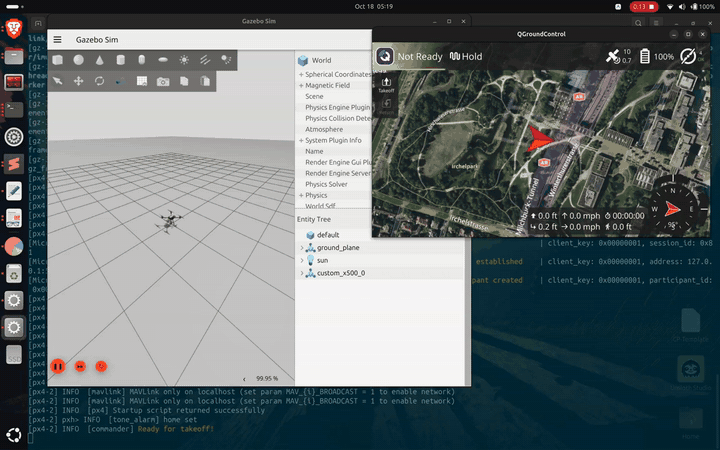
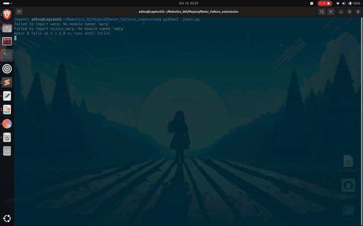
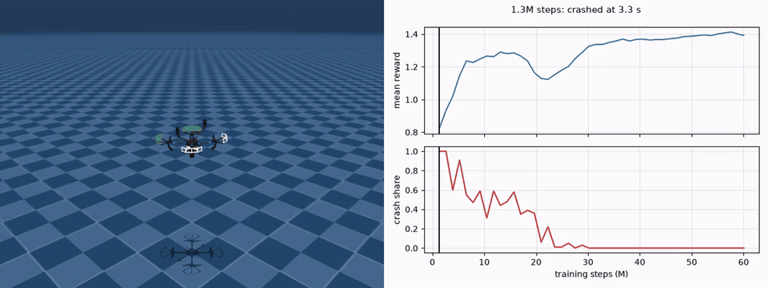
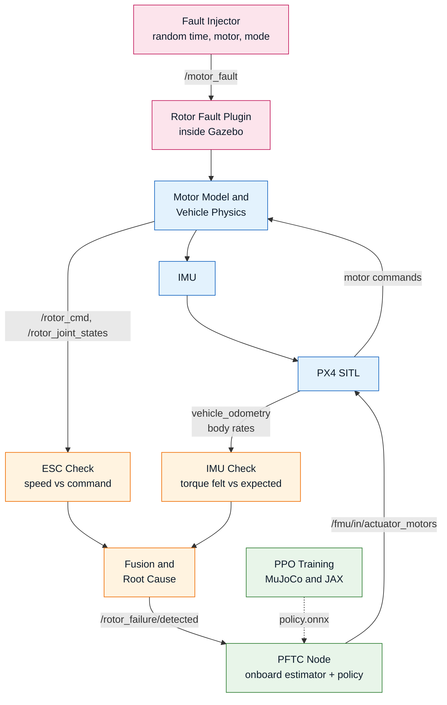

# Quadrotor Single Motor Failure: Detection and Recovery

A quadrotor that loses one motor in flight, works out **that** a motor failed, **which** one and **why**,
and then keeps flying on the remaining three rotors with a learned fault-tolerant controller.

Built on ROS 2 Jazzy, PX4 SITL and Gazebo Harmonic for the flight pipeline, and on MuJoCo and JAX for the
controller training. Everything below runs in simulation; nothing has been flown on hardware.

---

## Demo







---

## How it works

A real broken motor does not announce itself, so the fault is injected **underneath PX4**, inside the Gazebo
physics. PX4 is never told and keeps flying in whatever mode it was in.

Two checks then run at 50 Hz and are fused into one verdict:

- **Does the rotor spin as commanded?** The ratio of measured to commanded rotor speed flags a motor that is
  slow or stopped.
- **Does the body feel the torque it should?** The torque the IMU felt is compared with the torque the commanded
  speeds should have produced. The missing torque points at the missing rotor, even when the rotor still spins.

The fusion names the failed motor and the cause: a dead motor, a weak motor, or a lost propeller.

On a complete rotor loss the three remaining rotors cannot hold the drone level, so the drone spins about its
vertical axis. PX4's own estimator and controllers do not work in that state. A neural-network policy takes over
60-180 ms after the fault. It outputs the thrust of the three remaining rotors directly, using a small onboard
state estimator in place of EKF2. The policy is trained with PPO in MuJoCo on the same X500 v2 model.

---

## Pipeline



The learned policy is trained once in MuJoCo, exported to ONNX, and run inside the ROS node. The two halves of
this repository share only that file.

---

## The blocks

| Block | What it does |
|---|---|
| **Fault Injector** | Waits 15 s, then fires one fault at a random moment, on a random motor, in a random mode (`stop`, `weak`, `prop`). Marks the moment in PX4's `.ulg` log. |
| **Rotor Fault Plugin** | A Gazebo system that overrides the motor model for the faulty rotor. It models a full stop, a weak motor and a lost propeller. |
| **ESC Check** | Compares each rotor's measured speed with its commanded speed. |
| **IMU Check** | Compares the felt body torque with the torque the commanded speeds should give. |
| **Fusion and Root Cause** | Combines both checks into failed motor, cause and severity. Holds the first verdict. |
| **PFTC Node** | Takes over after the detection. Runs the onboard state estimator and the policy at 100 Hz, then flies a controlled descent and landing. |
| **PPO Training** | Trains the policy in a batched MuJoCo/JAX simulator, with domain randomisation and a curriculum of stages. |

---

## Headline results

| | |
|---|---|
| Detection, isolation **and** root cause | 100 % on 24 test runs and 6 extra live runs, 80 ms mean and worst |
| False alarms | 0 in 13.0 minutes of healthy flight |
| Recovery, complete rotor loss | 128/128 runs, 0.11-0.12 m position error after the fault |
| Same policy on PX4's own EKF2 | 0/8, ground contact at 2.7-3.0 s |
| Recovery, partial loss (30-80 % thrust left) | 80/80 runs |
| Landing | 16/16 runs passed every gate |
| MuJoCo benchmark, rotor 0 stopped at 3 s | the stock Mellinger controller crashes at 3.41 s; the policy loses 0.19 m of altitude |

The numbers are from simulation. The 13-minute healthy-flight log is not shipped. Details are in the two section
READMEs below.

---

## Repository layout

```
Rotor_Failure_Submission/
├── code/
│   ├── px4_ws/src/
│   │   ├── rotor_fail/        # ROS 2 package: injector, Gazebo plugin, detector, recovery node, launch files
│   │   └── px4_msgs/          # PX4 message definitions, pinned
│   └── mujoco/Rotor_Failure_submission/
│                              # PPO training, evaluation, stress tests, exported policy
├── bench/                     # benchmark harness for the Gazebo side, plus recorded results
├── docs/                      # detector benchmark, state-estimation study, experiment log
├── media/                     # demo GIFs and screenshots
└── README.md
```

| Document | What it is |
|---|---|
| [`code/px4_ws/src/rotor_fail/README.md`](code/px4_ws/src/rotor_fail/README.md) | Gazebo and PX4 half: every node, topic, parameter and launch command, plus the detector maths |
| [`code/mujoco/Rotor_Failure_submission/README.md`](code/mujoco/Rotor_Failure_submission/README.md) | MuJoCo and RL half: vehicle model, the maths of flying on three rotors, training chain, robustness tests |
| [`code/mujoco/Rotor_Failure_submission/FINAL_POLICY.md`](code/mujoco/Rotor_Failure_submission/FINAL_POLICY.md) | One-page spec of the submitted controller |
| [`docs/REPORT_2c.md`](docs/REPORT_2c.md) | Detector benchmark: protocol, metrics, tuning, limits |
| [`docs/state_estimation.md`](docs/state_estimation.md) | Why EKF2 fails after a rotor loss, and what replaces it |
| [`docs/EXPERIMENTS.md`](docs/EXPERIMENTS.md) | Dated experiment log |
| [`bench/README.md`](bench/README.md) | Which benchmark scripts run on a fresh checkout |

---

## Running it

### Gazebo and PX4

**Needs:** Ubuntu 24.04, ROS 2 Jazzy, Gazebo Harmonic, a PX4-Autopilot checkout built with `make px4_sitl`,
`MicroXRCEAgent`, QGroundControl, and `pip install onnxruntime numpy`.

```bash
cd code/px4_ws
colcon build --symlink-install --cmake-args -DPython3_EXECUTABLE=/usr/bin/python3
source install/setup.bash

# Gazebo, PX4, bridges, detector, injector, recovery node and QGroundControl
ros2 launch rotor_fail bringup.launch.py
```

Use `ftc:=false` for detection only, `px4_dir:=<path>` if PX4-Autopilot is not at `~/PX4-Autopilot`, and
`qgc_path:=<AppImage>` to start QGroundControl. Launch arguments and benchmark commands are in the
[package README](code/px4_ws/src/rotor_fail/README.md).

### MuJoCo and RL

**Needs:** Python 3.12, JAX, MuJoCo, and crazyflow v0.4.0 at commit `c95f69b` with the patch in `third_party/`.

```bash
cd code/mujoco/Rotor_Failure_submission
# install steps in RUN.md, then check the delivered policy:
cd policies/x500v2_i025a && sha256sum -c SHA256SUMS && python3 selftest.py   # must print PASS
cd ../.. && python main.py --motor 1    # viewer: hover, rotor 1 fails at 3 s, spinning recovery
```

Install, reproduction and retraining commands are in [`RUN.md`](code/mujoco/Rotor_Failure_submission/RUN.md).

---

## Status

**Working in simulation:** fault injection with three fault models, detection with root cause, a benchmark of the
detector, the onboard state estimator, recovery from a complete rotor loss and from partial loss, controlled
descent and landing, and the full RL training chain.

**Not built yet:** flight on real hardware. ESC telemetry is replaced by the simulated rotor joint speed, and a
real GPS, gyro and ESC would each add errors the simulation does not model. The Gazebo benchmark scripts that
read recorded flight logs need the flights to be re-flown, because the logs are not shipped.

---

## References

- Mellinger and Kumar, *Minimum Snap Trajectory Generation and Control for Quadrotors*, ICRA, 2011 — the baseline controller in the MuJoCo benchmark.
- Schulman et al., *Proximal Policy Optimization Algorithms*, 2017 — the algorithm that trains the policy.
- Holybro X500 v2 development kit — the airframe both simulators model.
- PX4 Autopilot, Gazebo Harmonic, uXRCE-DDS — the flight stack and simulator.
- crazyflow — the JAX-batched simulator the MuJoCo side is built on.

---

## License

MIT — see [`LICENSE`](LICENSE).
