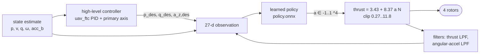

# Learned Passive Fault-Tolerant Control of an X500 v2 Quadrotor: the MuJoCo / RL Side

This folder is the simulation and reinforcement-learning half of our answer to the Mock PS *Quadrotor Single Motor
Failure* problem statement (the PDF is not part of this repo). It contains:

- the quadrotor model and the maths of flying on three rotors;
- a one-command baseline benchmark;
- the training of the fault-tolerant controller that the PX4 side deploys (`policies/x500v2_i025a`);
- its robustness and sim-versus-real analysis.

Fault injection, detection, the onboard estimator, the handover, landing and every PX4 SITL + Gazebo result are in
the PX4 README (`../../px4_ws/src/rotor_fail/README.md`). They are not repeated here, except for one line where
they back a claim.

Every number has a source: a file path, plus a line number or a table name. All plots are produced by the scripts named
next to them. **`FINAL_POLICY.md`** is the one-page technical record of the submitted controller alone (i025a).

A video of a policy learning from scratch is at [`../../../media/mujoco/training.gif`](../../../media/mujoco/training.gif);
it is made by `training_video.py` from the snapshots that `train.py --snaps` writes (see `RUN.md`).

---

## Summary

1. **Controller:** a passive fault-tolerant controller (PFTC). A fixed high-level position controller and a learned
   low-level policy (27 inputs, 4 rotor thrusts out) never need to be told which rotor failed.
2. **The policy:** i025a, trained with PPO in a JAX/MuJoCo-family simulator (crazyflow) on a model of the Holybro
   X500 v2 (1.40 kg, T/W 3.4) matched to our Gazebo drone.
3. **Baseline:** with rotor 0 cut at 3 s, the stock geometric controller (Mellinger) flips at 3.41 s. PFTC recovers in
   1.4 s with 0.19 m altitude loss, 40° peak tilt, 0.04 m final xy error and a 26 rad/s yaw spin (§1d,
   `report/benchmark_kpis.md`).
4. **Maths check:** the relaxed-hover equilibrium predicts the simulated spin rate to 2 % (28.0 vs 28.6 rad/s) and
   the free rotor thrust to 0.01 N (§1b, `report/relaxed_hover.txt`).
5. **Fault table** in the replica of the PX4 bench (`bench_sim.py`, 20 runs each), complete stop, prop loss, and
   partial loss with 30/50/65/80 % thrust left:
   - 0 crashes in hover and in all 5 flight phases;
   - xy error 0.07–0.13 m, or 0.36–0.72 m at 65–80 % thrust left
     (`policies/x500v2_i025a/results.txt` l. 18–24).
6. **Symmetry:** the policy is exactly symmetric by construction (equivariance error 2.4e-7). From matched starts,
   all four motors give identical results (`results.txt` l. 30–41).
7. **Replica vs Gazebo:** the sim replica predicted the Gazebo bench conservatively. For i022c, peak tilt came out
   2–12° high and xy error 0.04 m high (`runs/EXPERIMENTS.md` l. 219–226). On PX4 SITL with the onboard estimator,
   i025a survived 128/128 runs (PX4 README, Recovery).
8. **Held-out airframe errors:** mass ±10 % went from 6/20 crashes (i022c) to 0/20 (i025a); mass, thrust-curve,
   motor-lag and inertia errors all hold at 0 crashes (`results.txt` l. 53–57).
9. **What breaks first** (`runs/i025a/stress_report.txt`):
   - a CG offset of 1 cm toward the failed rotor;
   - 3° thrust-axis tilt;
   - more than 40 ms actuation delay;
   - growing heading error from a real gyro.

   The CG case is a learned-solution limit, not physics (§6).
10. **Not done here:** Task 1a team survey, intermittent faults, any real flight.

---

## Notation

| Symbol | Meaning | Value for the x500v2 (source: `crazyflow/.../first_principles/params.toml [x500v2]`) |
|---|---|---|
| $\mathbf p, \mathbf v$ | position, velocity in the world frame W (z up) | m, m/s |
| $R$ | rotation body frame B → W; $\mathbf e_3=(0,0,1)^\top$ | B: x forward, y left, z up |
| $\boldsymbol\omega=(\omega_x,\omega_y,\omega_z)$ | body angular rates | rad/s |
| $f_i,\ \Omega_i$ | thrust and speed of rotor $i\in\{0,1,2,3\}$ | $f_i=k_F\Omega_i^2$, $0\le f_i\le f_{\max}$ |
| $k_F$ | thrust coefficient | 1.18e-5 N/(rad/s)² |
| $\kappa=k_M/k_F$ | rotor drag torque per thrust | 0.016 m |
| $s_i$ | yaw-torque sign of rotor $i$ (body reaction) | $(-1,-1,+1,+1)$ |
| $\mathbf r_i$ | rotor position in B | $(\pm l,\pm l, 0.069)$, $l=0.17678$ m |
| $m,\ J,\ g$ | mass, inertia, gravity | 1.40 kg, diag(0.0152, 0.0152, 0.028) kg m², 9.81 m/s² |
| $J_p$ | rotor + motor inertia | 2.65e-5 kg m² (Gazebo effectively uses 0.1× of it, see Training) |
| $f_{\max}$, $f_{\text{floor}}$ | max thrust, PX4 armed minimum | 11.8 N, 0.27 N |
| $c_D$ | Gazebo rotor-drag coefficient | 8.06428e-5 |

Rotor order is PX4's: 0 front-right (+l, −l) CCW, 1 back-left CCW, 2 front-left CW, 3 back-right CW. Rotor 1 is the
**partner** (diagonally opposite) of rotor 0.

---

## Task 1a: Inter IIT 13.0 teams

**Not done on this side.** We did not research the Inter IIT 13.0 team solutions for this part of the submission. The
only 13.0-related input we used is the PS's own reference list.

---

## Task 1b: Literature and maths

Papers this side builds on (the PX4 README lists the detection and estimation papers):

- Mueller & D'Andrea, ICRA 2014 (relaxed hover);
- Chen et al., IROS 2025, *Learning-based passive fault-tolerant control of a quadrotor with rotor failure*
  ([arXiv 2503.02649](https://arxiv.org/abs/2503.02649)): interface, high-level law, reward;
- Schulman et al., *Proximal Policy Optimization*, 2017 (PPO).

### 1. Quadrotor model

This is crazyflow's `first_principles` model (`crazyflow/crazyflow/dynamics/first_principles/dynamics.py` l. 108–175),
plus our Gazebo-matching rotor drag (`ftc.py` `_rotor_drag`, l. 163–185):

$$
\dot{\mathbf p}=\mathbf v,\qquad
m\dot{\mathbf v}=R\begin{bmatrix}0\\0\\\sum_i f_i\end{bmatrix}-mg\,\mathbf e_3+R\,\mathbf F_D,\qquad
\dot R=R[\boldsymbol\omega]_\times
$$

$$
J\dot{\boldsymbol\omega}=\boldsymbol\tau(f)+\boldsymbol\tau_D-\boldsymbol\omega\times J\boldsymbol\omega
+\boldsymbol\omega\times h\,\mathbf e_3 + \dot h\,\mathbf e_3,
\qquad h=J_p\sum_i s_i\Omega_i
$$

The terms:
- $h$ is the rotors' angular momentum about body z, with $s_i$ the yaw-torque signs. The two $h$ terms are crazyflow's
  `torque_inertia` as implemented: $(\omega_y h, -\omega_x h, \dot h)$.
- The rotor speeds follow first-order lags of 12.5 ms up and 25 ms down (`rotor_dyn_coef`).
- $\mathbf F_D,\boldsymbol\tau_D$ come from Gazebo's `MulticopterMotorModel` drag:
  $\mathbf F_{D,i}=-c_D\,\Omega_i\,\mathbf v_{\perp,i}$, where $\mathbf v_{\perp,i}$ is the in-plane velocity of rotor
  $i$ (body velocity plus $\boldsymbol\omega\times\mathbf r_i$), and $\boldsymbol\tau_D=\sum_i \mathbf r_i\times\mathbf F_{D,i}$.
  - The $\boldsymbol\omega\times\mathbf r_i$ part is what damps the yaw spin.
- A fault scales rotor $i$'s thrust and drag torque by $k_i$ (`apply_fault`, l. 187). $k_i=0$ is a complete loss. A
  prop loss keeps $\Omega_i$, so the rotor keeps its inertia and drag.

### 2. Control allocation

$$
\begin{bmatrix}T\\\tau_x\\\tau_y\\\tau_z\end{bmatrix}=A\,\mathbf f,\qquad
A=\begin{bmatrix}1&1&1&1\\ y_0&y_1&y_2&y_3\\ -x_0&-x_1&-x_2&-x_3\\ \kappa s_0&\kappa s_1&\kappa s_2&\kappa s_3\end{bmatrix}
=\begin{bmatrix}1&1&1&1\\-0.177&0.177&0.177&-0.177\\-0.177&0.177&-0.177&0.177\\-0.016&-0.016&0.016&0.016\end{bmatrix}
$$

- **Four rotors:** rank $A$ = 4, so any combination of thrust and three torques can be made.
- **One column zeroed (rotor 0 dead):** rank 3 (`report/relaxed_hover.txt` §1). The three remaining thrusts span only a
  3-D subspace of the four outputs. One output must give.

### 3. Why yaw is given up

Ask for level hover on rotors 1–3: $T=mg$ and $\tau_x=\tau_y=0$. These are three equations in three unknowns, so they
fix all three thrusts:

$$f_1=0,\qquad f_2=f_3=\tfrac{mg}{2}=6.87\ \text{N}\qquad(\texttt{report/relaxed\_hover.txt}\ \S2).$$

Then $\tau_z=\kappa(s_2f_2+s_3f_3)=0.016\cdot 13.73=0.220$ N m. Nothing is left to cancel it, so the yaw rate grows at
$\tau_z/J_{zz}=7.8$ rad/s². With three rotors you can have roll balance, pitch balance and lift, or yaw balance, but
not all four.

The spin stops growing when the speed-dependent yaw damping of the rotor drag balances $\tau_z$. That damping is
$c_D\sum_i\Omega_i|\mathbf r_{i,xy}|^2=0.0077$ N m/(rad/s), which gives a steady spin of about **28.6 rad/s** (same file).

**Relaxed hover / primary axis** (Mueller & D'Andrea, ICRA 2014):
- Accept the spin and control only the direction of one body-fixed **primary axis** $\mathbf n_B$ in the world.
- With constant body rates, the body rotates about $\boldsymbol\omega$. If $\boldsymbol\omega$ is vertical in the
  world, the thrust direction $R\mathbf e_3$ cones around the vertical. Its time average points up, so the drone
  hovers while spinning.
- The roll and pitch torques needed are then supplied partly by the gyroscopic terms $\boldsymbol\omega\times
  J\boldsymbol\omega$ and $\boldsymbol\omega\times h\mathbf e_3$, not only by thrust differences. That is what frees
  the third rotor's thrust.
- Tilting the primary axis steers the average thrust, so position can still be controlled.

The high-level controller below (from uav_ftc / Chen et al.) uses $\mathbf n_B=\mathbf e_3$.

### 4. The equilibrium for the x500v2

**Unknowns:** $f_1,f_2,f_3$ and the constant body rates $\boldsymbol\omega$ (6 in all).

**Conditions** (`relaxed_hover.py` `resid`, l. 33–48), with the spin axis vertical,
$\hat{\boldsymbol\omega}=\boldsymbol\omega/\|\boldsymbol\omega\|$:

$$
\boldsymbol\tau(f)+\boldsymbol\tau_D(\boldsymbol\omega)+\boldsymbol\omega\times h\mathbf e_3-\boldsymbol\omega\times J\boldsymbol\omega=\mathbf 0,
\qquad \Big(\sum_i f_i\Big)\,\hat\omega_z = mg .
$$

That is 4 equations in 6 unknowns: a 2-parameter family of equilibria. `relaxed_hover.py` reports two of them, solved
with SLSQP:

| Equilibrium | $f_0..f_3$ [N] | $\boldsymbol\omega$ [rad/s] | spin $\|\boldsymbol\omega\|$ | spin axis from body z |
|---|---|---|---|---|
| (a) least largest thrust | 0, 3.16, 5.71, 5.71 | (−3.57, 3.52, 14.11) | 15.0 rad/s | 19.6° |
| (b) $f_1,f_2$ fixed at the simulated values | 0, 0.14, 10.13, **3.69** | (3.49, 3.70, **27.54**) | **28.0 rad/s** | **10.5°** |
| simulated i025a, mean of the last 10 s of 40 s | 0, 0.14, 10.13, **3.68** | (3.42, 3.63, **28.17**) | **28.6 rad/s** | mean tilt **10.3°** |

Source: `report/relaxed_hover.txt` §3 (`python relaxed_hover.py --sim --cg`).

- **The model matches the simulation.** Given the two thrusts the policy chose, the equations predict the third
  thrust to 0.01 N, the spin to 2 % and the spin-axis tilt to 0.2°. The residual of the equations at the simulated
  mean state is at most 0.006 (N m, N).
- **The policy picked an unbalanced point.** It sits at a corner of the family, with the partner rotor near zero and
  rotor 2 near 10 N, not at the balanced point (a). That matters for the CG limit in §6.
- **The spin is set by the drag damping:** 28.6 rad/s, the same value as the naive estimate in §3.

### 5. Detection maths

This is on the PX4 side (PX4 README, *Detection*: ESC speed ratio, IMU torque residual and root cause). The policy
here is passive: it gets no fault signal (§4, observation).

---

## Task 1d: Baseline benchmark

**One command** (from this folder, under a minute on the GPU):

```bash
python run_benchmark.py            # rotor 0 stops at 3 s
python run_benchmark.py --prop     # rotor 0 loses its propeller (keeps spinning) at 3 s
```

**What it runs** (`run_benchmark.py`):
- **Scenario:** both controllers fly the same scenario on the same plant. The x500v2 model with Gazebo's
  speed-dependent rotor drag hovers at 1.5 m; rotor 0 fails completely at 3 s; the run lasts 15 s. There is no
  actuation delay and the state is exact.
- **Mellinger:** crazyflow's stock geometric controller (position plus attitude, yaw held at 0). It stands in for a
  stock PX4-style cascade that keeps controlling yaw and does not know about the fault. Its x500v2 gains are copied
  from crazyflow's hb_x500 set (`third_party/crazyflow_x500v2.patch`); healthy hover error is 0.008 m
  (`runs/EXPERIMENTS.md` l. 35).
- **PFTC i025a:** the controller of §4, `runs/i025a/policy.pkl`.

**KPIs** (`run_benchmark.py` `kpis`, l. 75–96). Here $t_f$ is the failure time, $\mathbf p^*$ the hold point, and
$\theta=\arccos R_{33}$ the tilt. Values after a crash are excluded.

| KPI | Definition |
|---|---|
| altitude loss | $\Delta z=z(t_f)-\min_{t\ge t_f}z(t)$ |
| max tilt | $\max_{t\ge t_f}\theta(t)$ |
| max horizontal drift | $\max_{t\ge t_f}\lVert\mathbf p_{xy}(t)-\mathbf p_{xy}(t_f)\rVert$ |
| xy RMS last 5 s | $\sqrt{\operatorname{mean}_{t\in[10,15]\,\text{s}}\lVert\mathbf p_{xy}-\mathbf p_{xy}(t_f)\rVert^2}$ |
| time to recover | $t_{\text{rec}}-t_f$, where $t_{\text{rec}}$ is the first time after which $\lVert\mathbf p-\mathbf p^*\rVert<0.5$ m for the rest of the run |
| spin rate | $\operatorname{mean}_{t\in[10,15]\,\text{s}}\lvert\omega_z\rvert$ |
| crash | $z<0.1$ m or $\theta>90°$ |

**Results** (`report/benchmark_kpis.md`):

| KPI | Mellinger, stop | PFTC, stop | Mellinger, prop loss | PFTC, prop loss |
|---|---|---|---|---|
| crash at | 3.41 s | – | 3.41 s | – |
| altitude loss | 0.36 m (until the crash) | 0.19 m | 0.36 m | 0.16 m |
| max tilt | > 90° | 40.5° | > 90° | 36.4° |
| max horizontal drift | 0.09 m (until the crash) | 0.49 m | 0.09 m | 0.95 m |
| xy RMS last 5 s | – | 0.04 m | – | 0.07 m |
| time to recover | never | 1.40 s | never | 2.37 s |
| spin rate | – | 25.9 rad/s | – | 16.9 rad/s |

**Plots** (position, attitude, body rates, rotor thrusts vs time; the dashed line is the failure):
- `report/figures/benchmark_motor0_stop.png`
- `report/figures/benchmark_motor0_prop.png`

**What the plots show:**
- **Mellinger** keeps commanding yaw. It saturates rotors 2 and 3 against the missing torque and flips within
  0.41 s. The plot is blanked after the crash.
- **PFTC:**
  - lets the yaw rate build up to the drag-limited spin;
  - drives the partner rotor 1 to about 0 N;
  - shares the weight between rotors 2 and 3;
  - is back within 0.5 m of the hold point after 1.4 s.

The slow rise of the spin rate after 10 s is the rotor-drag equilibrium being approached (§1b.4).

---

## Bonus: Controller for stable hover on three rotors (PFTC)

### Architecture



**High-level controller** (uav_ftc gains; `ftc.py` `high_level`, l. 220–244; numpy port in `pftc_ref.py`). It runs at
100 Hz:

$$
\mathbf v^{\text{cmd}}=\operatorname{clip}(\mathbf p^*-\mathbf p,\pm10),\qquad
\mathbf a=\operatorname{diag}(2,2,6)(\mathbf v^{\text{cmd}}-\mathbf v),
$$

with the horizontal part of $\mathbf a$ limited to a 10° tilt and $a_z$ clipped to ±5 m/s². Then

$$
\mathbf n_{\text{des}}=\frac{\mathbf a+g\mathbf e_3}{\lVert\mathbf a+g\mathbf e_3\rVert},\qquad
\mathbf h=R^\top\mathbf n_{\text{des}},\qquad h_3=\max(h_z,0.1),
$$

$$
\mathbf t=-5\,\mathbf h_{xy}-\omega_z\,(h_y,-h_x)-(R^\top\dot{\mathbf n}_{\text{des}})_{xy},\qquad
p_{\text{des}}=t_y/h_3,\quad q_{\text{des}}=-t_x/h_3,\quad a_{z,\text{des}}=\lVert\mathbf a+g\mathbf e_3\rVert .
$$

This is the primary-axis law with $\mathbf n_B=\mathbf e_3$. It asks for body rates that turn body z toward
$\mathbf n_{\text{des}}$, and it never asks for a yaw rate. All three commands are low-passed at 50 rad/s.

**Low-level policy.** It replaces the rate controller and the allocator.
- **Input:** a 27-d observation (`ftc.observe`, l. 246–258; table in `policies/x500v2_i025a/INTERFACE.md`):

  | Entries | Content |
  |---|---|
  | $(\mathbf p-\mathbf p^*)/5$, $\mathbf v/5$ | position error and velocity |
  | quaternion (w ≥ 0) | attitude |
  | $\boldsymbol\omega/(5,5,20)$ | body rates |
  | 4 low-passed last thrusts / 10 | what the rotors were last told |
  | $\mathbf a_b/(5,5,20)$ | specific force |
  | $p_{\text{des}}/5,\ q_{\text{des}}/5,\ 0,\ a_{z,\text{des}}/20$ | high-level commands |
  | angular acceleration / 50 (LPF, $\tau$ 0.12 s) | rate of change of the body rates |

  **No fault information** is in it: the policy infers the fault from how the drone responds.
- **Output:** $a\in[-1,1]^4$, mapped to thrust $f_i=\operatorname{clip}(3.433+8.367a_i,\ 0.27,\ 11.8)$ N
  (hover + span to max).

**Network: a symmetric selector–controller** (`train.py` `Joint` l. 119–137, `mix_weights` l. 73–80,
`expert_out` l. 89–94).

Let $T_i$ be the mirror/rotation of the drone that maps rotor $i$ onto rotor 0 (`ftc.TO_MOTOR0`), and $P_i$ the matching
permutation of the rotors.
- **Fault copies.** One base MLP $\pi_0$ (3×64 tanh, trained for "rotor 0 failed") gives four fault controllers,
  $\pi_i(\mathbf o)=P_i^{-1}\pi_0(T_i\mathbf o)$.
- **Healthy expert.** A healthy-flight expert $\pi_H$ is averaged over the four symmetries.
- **Selector.** A selector network $\sigma$ scores "rotor $i$ failed" only on $T_i\mathbf o$, the view in which rotor
  $i$ looks like rotor 0. It outputs softmax weights $w_i$ over the 4 fault modes plus "healthy".
- **The action** is $\sum_i w_i\pi_i+w_H\pi_H$.

By construction $\pi(T\mathbf o)=P\,\pi(\mathbf o)$ for every symmetry. The measured error is 2.4e-7
(`policies/x500v2_i025a/results.txt` l. 10–16). So a failure of any rotor is flown exactly like the mirror image of a
rotor-0 failure.

**Shadow mode.**
- **Before the fault:** PX4 flies. The policy wrapper `pftc_ref.PFTC.track()` runs every 10 ms on the true state and
  on the thrusts PX4 applies, so the filters and the high-level states are warm.
- **At detection:** `step()` takes over without a reset.
- **Why it matters:** a cold start 80 ms into a failure crashed 20/20 in our model (`runs/EXPERIMENTS.md` l. 159–162).
  The PX4 node copies `pftc_ref.py` verbatim.

### Training

**PPO** (`train.py` l. 317–375; Schulman et al. 2017), written in JAX:
- **Batch:** $N$ parallel simulators × horizon 64 steps at 100 Hz (physics at 500 Hz). $N$ = 16384 on the GPU,
  4096 on the CPU.
- **Updates:** 4 epochs × 8 minibatches; clip 0.2; $\gamma$ = 0.99; GAE $\lambda$ = 0.95; Adam; lr 1e-4 for
  fine-tunes; gradient-norm clip 0.5; value coefficient 0.5; reward scale 0.1.
- **Policy distribution:** a Gaussian with a learned per-dimension $\log\sigma$, reset to $\sigma$ = 0.1 at the start
  of each fine-tune.
- **Selector:** trained by a supervised loss $\lVert\mathbf w-\mathbf w^{\text{label}}\rVert^2$ (Chen et al. eq. 4),
  where the label is the true failed rotor after the fault and "healthy" otherwise.
- **Masked steps:** PPO steps flown by the PX4 stand-in before the handover are masked out of the loss.

**Reward** (`ftc.py` l. 417–439). Let $\mathbf e=\mathbf p-\mathbf p^*$ and $u_k$ the thrust command at step $k$:

$$
r=\begin{cases}1.5-\min(P,1) & \text{alive}\\ 0 & \text{crash (episode ends)}\end{cases}
$$

$$
P = 0.1\lVert\mathbf e\rVert^2+0.01\lVert\mathbf v\rVert^2
+0.02\big[(\omega_x-p_{\text{des}})^2+(\omega_y-q_{\text{des}})^2+c_z\big]
+0.0008\lVert u_k-u_{k-1}\rVert^2+0.2\,(a_{b,z}-a_{z,\text{des}})^2
$$

$$
+\;0.3\big(1-e^{-\lVert\mathbf e\rVert^2/0.25^2}\big)
\;+\;\max(0.342-R_{33},0)/0.342
$$

- **The first line** is Chen et al.'s reward and weights.
- **$c_z$:** $c_z=\omega_z^2$ while yaw is controllable (healthy, or the weakest rotor still at ≥ 50 %). After a severe
  fault, $c_z=\max(\lvert\omega_z\rvert-40,0)^2$, so the spin is free up to 40 rad/s.
- **The "precision" term** (from i019): the paper's $0.1\lVert\mathbf e\rVert^2$ costs only 0.01 for a 0.3 m orbit.
  This term adds up to 0.3 near the target.
- **The tilt term** (from i022): it costs up to 1 for tilt beyond 70°. The bench counts 90° as a flip.
- **Positivity:** the alive bonus keeps $r>0$, so ending an episode never pays.
- **Crash:** $z<0.1$ m, 3 m from the target, upside down, $\lVert\boldsymbol\omega\rVert>80$ rad/s, or NaN
  (`is_crashed`, l. 441).

**Episodes and randomisation** (`train.py` `sample_resets`, l. 213–282). Episodes last 15 s and start within ±0.5 m of
the target. In half of them one rotor fails at a random time in 1–4 s.

| What | Range | Why (first run that added it) |
|---|---|---|
| fault type | complete loss; within faults 50 % prop loss (rotor keeps spinning); 30 % partial loss with $k$ ~ U(0.3, 0.8) | bench fault table (i019, i025a) |
| flight state at the fault | 70 % start moving: $\lvert v_{xy}\rvert\le2.5$ m/s, $\lvert v_z\rvert\le1.2$ m/s, $\lvert\omega_z\rvert\le2$ rad/s, any heading; fault 0–0.5 s later | tilt > 90° in climb/yaw phases on the bench (i021, i022) |
| actuation delay / state lag / state noise | 0–20 ms / 0–20 ms / 0–1 × EKF-like σ | Gazebo/PX4 latency (i018) |
| rotor drag scale, thrust floor | 0.5–1.5 × Gazebo drag; 0.27 N floor | Gazebo rotor model, PX4 armed minimum (i018) |
| rotor inertia | 0.08–1.2 × physical, log-uniform | Gazebo runs the rotors at 0.1× (`rotorVelocitySlowdownSim` = 10) (i019) |
| PX4 before the handover | PX4's logged reaction (failed rotor to max, partner to floor) for 0–120 ms | logged `actuator_motors` (i020) |
| airframe errors | mass ±10 %, CG 0–2 cm, per-rotor thrust curve ±10 %, max thrust 85–100 %, motor lag 0.8–2×, J ±20 % | held-out test showed Gazebo overfit (i023) |
| onboard-estimator errors (80 % of episodes) | gyro scale ±3 % x/y and ±0.5 % z, bias ≤ 4°/s, heading offset ≤ 45°, a JAX copy of the bench's GPS/accel KF with 5–10 Hz GPS and 100–200 ms delay | bench's own estimator (i023) |

**The chain to i025a.** Each run fine-tunes the previous one (args in `runs/<id>/log.txt` line 1; results in
`runs/EXPERIMENTS.md`):

| Run | What it added | What it fixed (evidence) |
|---|---|---|
| i014a_m0 | PPO from scratch, rotor 0 only, 50 % healthy episodes, 120M steps | earlier bases spun up while still healthy; from scratch they hover flat (l. 81–90) |
| i016 | 5-mode selector over that base, healthy expert = the same base, 30M (supervised) | 0.080 m on all 4 motors, 0 crashes (l. 97–99) |
| i018 | joint PPO on the whole mixture, Gazebo-gap randomisation, 100M | survives the Gazebo gap (0.130 m) where i012/i014b crashed 20/20 (l. 136–159) |
| i019c | precision reward, rotor inertia 0.08–1.2×, prop loss, EKF-like attitude errors ≤ 20° | the 0.34 m orbit on the bench → 0.09–0.11 m (l. 168–199) |
| i020a | PX4 stand-in 0–120 ms before the handover | EKF 10–20° crashes 15–20 → 1 per 20 (l. 199) |
| i021c | moving starts (50 %), EKF errors ≤ 30° | climb and yaw phase crashes (l. 205–212) |
| i022c | moving starts 70 %, tilt penalty | 0 crashes in every phase, peak ≤ 89° (l. 214) |
| i023b | airframe and onboard-estimator randomisation, 150M | mass ±10 %: 6 → 0 crashes; all errors at once: 10 → 3 (l. 234–257) |
| **i025a** | **exactly symmetric selector and expert, partial loss 30–80 %**, 150M | partial 50 %: 7 → 0 crashes; per-motor spread 30 m → 0 (l. 259–276) |

**Training curves.** `report/figures/training_curves.png` shows the mean reward per step and the crash share of
finished episodes over all PPO stages (`python plot_report.py`, read from `runs/<id>/log.txt`).
- **Levels across stages are not comparable:** the reward terms and the randomisation change between stages.
- **The high crash share in late stages** (about 0.5–0.6) is deliberate: up to 45° heading errors, 2 cm CG offsets and
  120 ms of PX4 stand-in are inside the training distribution.

**Replica tables** (`bench_sim.py`: 20 runs per setting = 4 motors × 5 starts, PX4 stand-in for 80 ms, scored from
the handover to fault + 15 s, crash = tilt > 90° or height loss > 2.7 m):

| Setting (i025a) | Crashes /20 | xy RMS last 5 s | Peak tilt | Source |
|---|---|---|---|---|
| ground truth, stop / prop | 0 / 0 | 0.12 / 0.13 m | 72° | `policies/x500v2_i025a/results.txt` l. 19–20 |
| 5 flight phases (hover, 2 m/s forward, ±1 m/s climb/descent, 1.5 rad/s yaw) × stop/prop | 0 in all | 0.12–0.13 m (forward 0.77 m*) | 70–82° | `results.txt` full table l. 62–75 |
| partial 30 / 50 / 65 / 80 % thrust left | 0 / 0 / 0 / 0 | 0.09 / 0.07 / 0.72 / 0.36 m | 53 / 36 / 6 / 3° | `results.txt` l. 21–24 |
| handover 0 / 80 / 120 / 160 ms | 0 / 0 / 0 / 0 | – | ≤ 86° | `results.txt` l. 42–43 |

\* For forward flight, the target stays at the start point while the drone has already flown 0.7 m by the handover.

**The replica checked against Gazebo** (i022c, the same protocol on PX4 SITL; `runs/EXPERIMENTS.md` l. 219–226):

| | Replica | Gazebo |
|---|---|---|
| xy error | 0.11 / 0.13 m | 0.07 / 0.09 m |
| peak tilt | 76° | 74–76° |
| altitude loss | 0.54 m | 0.50–0.67 m |
| phase crashes | 0 | 0/40 |

The replica is slightly pessimistic everywhere it was checked. i025a on PX4 SITL: 128/128 runs survived with the
onboard estimator (PX4 README, *Recovery*).

### What is reused and what is ours

| Item | Origin | What we changed |
|---|---|---|
| Simulator | [crazyflow](https://github.com/learnsyslab/crazyflow) v0.4.0 (JAX + MuJoCo) | added drone `x500v2` (params, MJCF, Mellinger section): `third_party/crazyflow_x500v2.patch`. No other crazyflow code changed. |
| Interface: high-level law, 27-d observation, reward, selector-controller | Chen et al., IROS 2025 ([arXiv 2503.02649](https://arxiv.org/abs/2503.02649)); code [uav_ftc](https://github.com/HITSZcjh/uav_ftc) (the PS lists it as Tianxing-Chen/uav_ftc) | re-implemented in JAX (`ftc.high_level`, `observe`), same gains. Ours: 10° tilt limit and $h_3$ guard; per-motor PX4 order; the precision and tilt reward terms; the exactly equivariant selector and expert (the paper's selector is a free network). |
| Rotor-failure physics on top of crazyflow | ours (`ftc.py`) | per-world faults, prop loss, Gazebo rotor drag, delay queue, floor, PX4 stand-in, estimator models, plant randomisation |
| PPO, GAE, symmetry maps, joint training, ONNX export (`export_onnx.py`), numpy runner (`pftc_ref.py`), replica (`bench_sim.py`), stress test (`stress.py`), maths (`relaxed_hover.py`), benchmark | ours | – |
| Relaxed-hover equations | Mueller & D'Andrea, ICRA 2014 | solved numerically with our plant terms (rotor drag, gyroscopics, CG) |

**What failed** (all in `runs/EXPERIMENTS.md`):
- **v1 on a different airframe** (crazyflow hb_x500) worked (0.060 m, l. 18), but that airframe matched no real
  drone.
- **On the x500v2 the first bases spun up while still healthy** ("pre-spinning"), so the selector switch crashed 20/20.
  Four curriculum and reward fixes failed (l. 42–79) before training from scratch with healthy episodes worked
  (l. 81–90).
- **Policies trained before the Gazebo-gap model** crashed 20/20 on it (l. 136–151).
- **EKF2 as the state source** stayed at 0/8 on PX4 for every policy; EKF robustness training topped out at about 10°
  of attitude error. It was replaced by the onboard estimator (l. 219–233).
- **i024a/b** (CG offset toward the failed rotor), **i026a/b** (thrust tilt, wider latency) and **i025b** failed the
  gate and were not taken (l. 252–255, 272, 296–310).

---

## Optional Track A: KPIs and optimisation

**KPI formulas.** These are the Task 1d table, plus the following:
- **Peak motor saturation:** $\max_{t\ge t_f}\max_i f_i/f_{\max}$. Not tabulated; in the Task 1d plots no rotor
  of i025a reaches 11.8 N after the fault (max about 10 N), while Mellinger saturates rotors 2 and 3.
- **Detection-to-control handover tolerance:** the largest handover delay with 0 crashes, which is 160 ms (`results.txt` l. 42).
- **Compute cost per control step:**
  - 125,459 multiply-accumulates per call;
  - 41 µs per call on one laptop CPU core (i9-14900HX; onnxruntime 1.31, 1 thread, batch 1, mean of 5,000 calls);
  - about 0.5 ms on a 480 MHz STM32H7 FPU (an **estimate** from 125k MACs plus 2,300 tanh, not measured), which is 5 %
    of the 10 ms step.
- **Two more KPIs** (ours, from the PX4 bench analysis, not taken from a paper):
  - **orbit radius**, the RMS about the mean position over the last 5 s (`bench_sim.py` `orbit_radius`), which exposed
    i018's 0.34 m orbit;
  - **tolerated estimator error**, the largest heading offset or gyro bias with 0 crashes. Ours: heading offset ≤ 20–30°,
    gyro bias ≤ 4°/s (`results.txt` l. 45–52).

**The optimisation method** is PPO on the reward above, and the reward weights are the KPIs' surrogate. Candidates are
tuned and promoted by a fixed protocol:
- every change is a fine-tune from the current best, with a stated hypothesis;
- every candidate is scored on the same replica settings;
- a candidate is taken only if it does not regress on any gate setting: ground truth, phases, airframe errors,
  estimator, partial loss and handover.

Within a run, the candidate pairs differed in one setting (e.g. EKF range 20 vs 40°, partial share 0.3 vs 0.5,
tilt range 3 vs 4°).

**Trade-off.** `report/figures/pareto.png`, data in `report/pareto.md` (`python plot_report.py`).
- **Axes:** precision (hover xy error after a complete loss) against robustness (crashes summed over 72 replica
  settings).
- **Data:** the five candidates scored on partial loss as well.
- **The front:** i025b (97 crashes, 0.139 m), **i025a (106, 0.126 m)** and i023b (136, 0.117 m).

**We fly i025a.** i025b has fewer crashes but holds yaw at 50–65 % partial loss and drifts 1.2–3.7 m there, against
0.07–0.72 m for i025a (`runs/EXPERIMENTS.md` l. 270–272). i023b is more precise but crashes 5–7/20 at 50–65 % partial
loss, and it is not symmetric.

---

## Bonus: Simulation vs real world

**1. Held-out airframe errors.** These are never trained on at these widths. The policy flies the healthy drone before
the fault, as PX4 would. Crashes per 20 (`bench_sim.py` `hw_*`/`hwx_*`; i022c from `runs/EXPERIMENTS.md` l. 240–241,
i025a from `results.txt` l. 53–57):

| Error | i022c (Gazebo-only training) | i025a |
|---|---|---|
| mass ±10 % | 6 | 0 (xy 0.08 m) |
| CG offset 1–2 cm | 3 | 4 |
| per-rotor thrust ±10 %, sag to 85 % | 0 (xy 0.36 m) | 0 (xy 0.18 m) |
| motor lag 2× / inertia ±20 % | 0 / 0 | 0 / 0 |
| all at once | 10 | 3–5 |
| wider: mass ±15 %, thrust ±15 % + sag 0.8, lag 2.5×, J ±30 % | 3–4, 3, 0, 0 | 0, 0, 0, 0 |

**2. Stress test, one error at a time, to failure.** `python stress.py runs/i025a/policy.pkl`; full output
`runs/i025a/stress_report.txt`.

| Error | Still fine | First failure (crashes /20) | Training range |
|---|---|---|---|
| CG toward the failed rotor | 0.75 cm | 1.0 cm (19) | 0–2 cm, random direction |
| thrust-axis tilt (bent mounts), all rotors | – | 3° (4) | none |
| actuation delay | 40 ms | 60 ms (16–17) | 0–20 ms |
| state lag | 40 ms | 60 ms (10–12) | 0–20 ms |
| motor lag | 3× | 4× (19) | 0.8–2× |
| battery sag (max thrust) | 0.7 | 0.6 (20) | 0.85–1 |
| all rotors' thrust curve | 0.7× | 0.6× (8) | ±10 % per rotor |
| heading offset (onboard estimator) | 45° (8 m drift) | 60° (1–3) | ≤ 45° |
| steady wind | 6 m/s (2 m drift) | 10 m/s (17) | none |
| fine at every value tested | mass 0.6–1.5×, J 0.4–2.5×, rotor inertia 0.03–3×, GPS down to 1/3 Hz, fault at 5 m/s forward or 4 rad/s yaw, gusts 3 ± 3 m/s, fault onset 0.5–5 s | – | – |

**3. Monte Carlo** (8,000 runs, everything drawn at once, `stress_report.txt` l. 152–205):
- **Brutal ranges:** 89 % crash.
- **Halfway ranges:** 46 % crash. The logistic regression ranks handover delay, CG toward the failed rotor, actuation
  delay, fault onset and motor lag as the main causes.

Total loop latency is the dominant combined factor.

**4. The CG limit is the learned solution, not physics.** Relaxed-hover equilibria exist up to 5 cm in every direction
with at most 6.2 N per rotor (`python relaxed_hover.py --cg`, `report/relaxed_hover.txt` §4).
- **Why the policy fails:** its own equilibrium parks the partner rotor at about 0.1–0.3 N (§1b.4). A CG shift toward
  the failed rotor needs even less partner thrust, which the 0.27 N floor does not allow.
- **What did not work:** two fine-tunes that over-sampled this case (i024a/b) moved it by at most 1/20 and lost
  motor-lag robustness.
- **Requirement for now:** CG within 0.5 cm of the motor centre.

**5. What breaks first on a real drone, in our estimate:**
1. **Heading drift of the gyro-integrated attitude.** With a real gyro, a 1 % z-axis scale error at 20 rad/s drifts
   heading by about 11°/s. The high-level law rotates its position correction by the heading error, so beyond about
   60–90° the drone drifts away. In the sim it does not crash at 1 % but drifts 25 m (`results.txt` l. 51). This is
   not trainable, so the estimator needs heading aiding (PX4 README, *State estimation*).
2. **CG and motor-mount alignment** (point 4, and 3° tilt crashing 4/20).
3. **Latency above 40 ms** end to end (ROS 2 → PX4 → ESC). This is unmeasured on hardware.
4. **Propeller aerodynamics during the 15–30 rad/s spin** (blade flapping, inflow) and **IMU vibration and
   saturation**. Neither is modelled; gyros saturate around 35 rad/s, and the spin is 14–28 rad/s.

---

## Reproducibility

**Hardware used:** Intel i9-14900HX (32 threads, at most 24 used), NVIDIA RTX 4060 Laptop 8 GB, Ubuntu 24.04.4.

**Software** (exact versions of the venv we used): Python 3.12.3; jax/jaxlib 0.11.2 + jax-cuda13-plugin 0.11.2; flax 0.12.10;
optax 0.2.8; mujoco / mujoco-mjx 3.8.1; numpy 2.4.4; scipy 1.17.1; onnx 1.23.2; onnxruntime 1.31.0; matplotlib
3.11.2; crazyflow 0.4.0 (commit c95f69b) + our patch.

**Install** (from this folder; crazyflow is not shipped, so clone it at the pinned commit and apply our patch):

```bash
python3.12 -m venv .venv && source .venv/bin/activate
git clone https://github.com/learnsyslab/crazyflow && git -C crazyflow checkout c95f69b
git -C crazyflow apply ../third_party/crazyflow_x500v2.patch     # adds the x500v2 drone
pip install -e crazyflow "jax[cuda13]==0.11.2" flax==0.12.10 optax==0.2.8 onnx onnxruntime matplotlib scipy
# CPU only: install "jax==0.11.2" instead and prefix commands with JAX_PLATFORMS=cpu
```

The patch was checked: applied to a clean v0.4.0 export, it reproduces our crazyflow tree exactly.

**Evaluate the delivered policy** (run in this folder; all use `runs/i025a/policy.pkl`):

| Command | Produces | Time (GPU) |
|---|---|---|
| `python run_benchmark.py` (and `--prop`) | Task 1d KPIs + plots | < 1 min each |
| `python relaxed_hover.py --sim --cg` | Task 1b numbers | ~1 min |
| `python bench_sim.py runs/i025a/policy.pkl --out x.json` | all replica settings | 5–10 min |
| `python stress.py runs/i025a/policy.pkl --mc-n 8000 [--mc-scale 0.5]` | stress sweep + Monte Carlo | ~3 min |
| `python plot_report.py` | training curves, Pareto | seconds |
| `python main.py --motor 1` | MuJoCo viewer: hover, failure, spinning recovery | live |
| `python export_onnx.py runs/i025a/policy.pkl out.onnx` | ONNX, checked against JAX (< 1e-5) | ~1 min |
| `cd policies/x500v2_i025a && python3 selftest.py` | replays a recorded episode through ONNX: PASS | seconds |

**Retrain i025a.** Run the chain in order. Each command's full argument list is line 1 of `runs/<id>/log.txt`. GPU at
16384 envs or CPU at 4096 envs (`JAX_PLATFORMS=cpu taskset -c 0-23`). The wall times are those we measured:

```bash
P=python; G="--gz-rand --joint --reset-std 0.1 --lr 1e-4 --p-fault 0.5"
$P train.py --id i014a_m0 --steps 1.2e8 --motor 0 --p-fault 0.5                                   # ~10 min, CPU
$P train.py --id i016 --steps 3e7 --base runs/i014a_m0/policy.pkl --expert runs/i014a_m0/policy.pkl --p-fault 0.9 --lr 1e-3   # ~2 min
$P train.py --id i018  --steps 1e8 --init runs/i016/policy.pkl  $G                                   # ~30 min
$P train.py --id i019c --steps 1e8 --init runs/i018/policy.pkl  $G --reward precise --delay-min 0 --prop-j 0.08 1.2 --p-spin 0.5 --ekf-rand 20
$P train.py --id i020a --steps 1e8 --init runs/i019c/policy.pkl $G --reward precise --delay-min 0 --prop-j 0.08 1.2 --p-spin 0.5 --ekf-rand 20 --handover 120 --envs 16384
$P train.py --id i021c --steps 1e8 --init runs/i020a/policy.pkl $G --reward precise --delay-min 0 --prop-j 0.08 1.2 --p-spin 0.5 --ekf-rand 30 --handover 120 --moving 0.5 --seed 1 --envs 4096
$P train.py --id i022c --steps 1e8 --init runs/i021c/policy.pkl $G --reward precise --delay-min 0 --prop-j 0.08 1.2 --p-spin 0.5 --ekf-rand 30 --handover 120 --moving 0.7 --tilt-pen 1 --envs 4096
$P train.py --id i023b --steps 1.5e8 --init runs/i022c/policy.pkl $G --reward precise --delay-min 0 --prop-j 0.08 1.2 --p-spin 0.5 --handover 120 --moving 0.7 --tilt-pen 1 --hw-rand --onboard 0.8 3 0.5 4 45 --envs 4096
$P train.py --id i025a --steps 1.5e8 --init runs/i023b/policy.pkl $G --reward precise --delay-min 0 --prop-j 0.08 1.2 --p-spin 0.5 --handover 120 --moving 0.7 --tilt-pen 1 --hw-rand --onboard 0.8 3 0.5 4 45 --equivariant --partial 0.3 --severity 0.3 0.8 --envs 16384   # ~75 min, GPU
```

Each fine-tune took 26–76 min (from the speeds in `runs/<id>/log.txt`), and the whole chain about 6 h. GPU speeds are
33–65k steps/s; the symmetric policy is the slowest.

**Honest limits of reproducibility:**
- **Bit-exact retraining is not possible.** The code evolved during the chain: random-number splits were added for new
  randomisations, and i014a_m0/i016 were trained before the x500v2 parameters became physical (`runs/EXPERIMENTS.md`
  l. 126–133). Re-running reproduces the method and statistically similar policies, not identical weights.
- **The trained weights of every stage are kept** in `runs/<id>/policy.pkl`, so any stage can be re-evaluated
  exactly.

---

## Files

```
Rotor_Failure_submission/
├── ftc.py               environment: x500v2 + faults, Gazebo-gap plugins, estimator and airframe models, high level, reward
├── train.py             PPO, symmetric selector-controller, randomisation (sample_resets)
├── eval.py              20-unit score, Mellinger baseline
├── bench_sim.py         replica of the PX4/Gazebo bench protocol (all settings in the tables above)
├── stress.py            one-at-a-time sweeps to failure + Monte Carlo with logistic regression
├── relaxed_hover.py     Task 1b: allocation, naive hover, relaxed-hover equilibrium, CG feasibility
├── run_benchmark.py     Task 1d one-command benchmark
├── plot_report.py       training curves and Pareto figures
├── export_onnx.py       policy.pkl -> policy.onnx with a parity check
├── pftc_ref.py          numpy + onnxruntime runner (what the PX4 node runs), shadow mode
├── main.py              MuJoCo viewer
├── policies/            x500v2_i025a: the delivered policy (ONNX, selftest, results, interface spec)
├── report/              generated tables and figures cited above
├── runs/                weights + log of every stage of the i025a chain, scores behind the figures, EXPERIMENTS.md
└── third_party/         crazyflow_x500v2.patch
```

## References

- M. W. Mueller, R. D'Andrea, *Stability and control of a quadrocopter despite the complete loss of one, two, or
  three propellers*, ICRA 2014.
- T. Chen et al., *Learning-based passive fault-tolerant control of a quadrotor with rotor failure*, IROS 2025,
  [arXiv 2503.02649](https://arxiv.org/abs/2503.02649); code [uav_ftc](https://github.com/HITSZcjh/uav_ftc).
- J. Schulman et al., *Proximal Policy Optimization Algorithms*, arXiv 1707.06347, 2017.
- [crazyflow](https://github.com/learnsyslab/crazyflow), [MuJoCo](https://mujoco.readthedocs.io),
  [JAX](https://jax.readthedocs.io), [Flax](https://flax.readthedocs.io), [Optax](https://optax.readthedocs.io).
- Holybro X500 v2 kit ([PX4 kit list](https://docs.px4.io/main/en/frames_multicopter/kits)); Gazebo
  `MulticopterMotorModel`.
