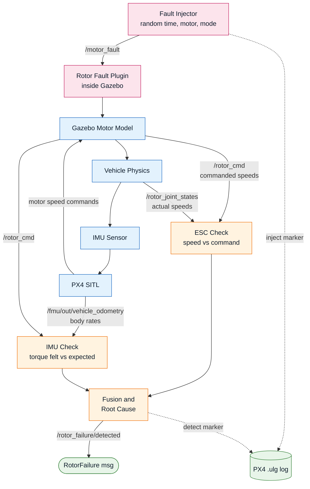
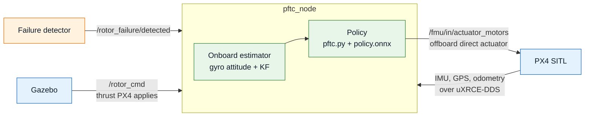

# Rotor Fault Injection, Detection and Recovery for a Quadrotor

A pipeline that breaks one motor of a quadrotor at a random moment in flight, then works out
**that** a motor failed, **which** one, and **why**: a dead motor, a weak motor or a lost propeller.
On a complete rotor loss it can hand the remaining three motors to a learned fault-tolerant
controller, which keeps the drone flying in a fast yaw spin and holds its position.

Built on ROS 2 Jazzy, PX4 SITL and Gazebo Harmonic, on a quadrotor matched to the Holybro X500 v2 kit. It covers the
fault injection and detection task (Task 2) of the *Quadrotor Single Motor Failure* problem
statement (not shipped in this repo), plus recovery on three rotors (see [Recovery](#recovery-learned-fault-tolerant-control)).

---

## Pipeline



Two things are easy to miss:

- **The fault is injected underneath PX4, inside the physics.** PX4 is never told and keeps
  flying in whatever mode it was in, exactly as with a real broken motor. No offboard mode is
  needed.
- **The two checks reach ROS through different bridges.** Body rates come from PX4's own state
  estimate over uXRCE-DDS (`MicroXRCEAgent`). Rotor commands and speeds come straight from Gazebo
  over `ros_gz_bridge`.

---

## The blocks

| Block | What it does |
|---|---|
| **Fault Injector** (`src/fault_injector.py`) | Waits 15 s, then fires one fault at a random moment. Picks a random motor and a random fault mode. Marks the moment in PX4's `.ulg` log. |
| **Rotor Fault Plugin** (`src/RotorFaultSystem.cpp`) | A Gazebo system attached to the drone. It runs after the motor model on every physics step and overrides it for the faulty rotor. Replaces PX4's `MotorFailurePlugin`, which can only do a full stop. |
| **Gazebo Motor Model** | Stock `MulticopterMotorModel`. Turns PX4's speed command into rotor spin, thrust (`k_F·ω²`) and yaw drag (`k_M·thrust`). |
| **PX4 SITL** | Stock PX4 X500 airframe and controllers. Reads the simulated IMU, runs EKF2 and publishes body rates. Its controllers are unchanged, so it does not recover from a motor failure. |
| **ESC Check** | Compares each rotor's measured speed with its commanded speed. In simulation the rotor joint speed stands in for ESC RPM telemetry. |
| **IMU Check** | Compares the torque the body actually felt with the torque the commanded speeds should have produced. The missing torque points at the missing rotor. |
| **Fusion and Root Cause** (`src/failure_detection.py`) | Combines both checks into one verdict: failed motor, cause and severity. Holds the first verdict, so the tumble after a failure can't change the answer. Marks the detection in the `.ulg` log. |

---

## Vehicle

The drone matches the **Holybro X500 v2**, the official PX4 development kit
([PX4 kit list](https://docs.px4.io/main/en/frames_multicopter/kits)). The same specs are used by the
MuJoCo model the recovery controller is trained on, so results carry over between the two simulators.
It is PX4's Gazebo `x500` model with the mass, inertia and thrust changed. Every value states its source:

| Parameter | Value | Source |
|---|---|---|
| Total mass | 1.40 kg (base 1.3357 + 4 rotors) | Estimate: Holybro ARF 610 g incl. motors, ESCs and props; + 4S 5000 mAh ~550 g; + Pixhawk 6C, GPS and power module ~200 g |
| Rotor position | ±0.17678 m in x and y, 0.069 m above the CoM | Kit spec: 500 mm wheelbase (500 / 2 / √2); height from the Holybro STEP. PX4's x500 model (±0.174) and its allocation geometry (`CA_ROTOR*`, 0.13 / 0.22) are replaced by this square layout |
| Inertia J (whole vehicle) | diag(0.0152, 0.0152, 0.028) kg·m² | PX4 x500 model (0.02167, 0.02167, 0.040 at 2.0 kg) scaled by mass 1.4 / 2.0. In Gazebo, `base_link` holds J minus the four rotor links, so the total matches |
| Max thrust per rotor | 11.8 N (`motorConstant` 1.18e-5 at 1000 rad/s) | Estimate: T-Motor AIR2216 II KV920 + T1045 on 4S, 1.2 kg limit, as a proxy for the Holybro 2216 KV920 (no published table) |
| Yaw torque ratio | 0.016 × thrust | PX4 x500 model `momentConstant` |
| Rotor lag | 12.5 ms up / 25 ms down | PX4 x500 model `timeConstantUp` / `timeConstantDown` |

- **Thrust-to-weight** = 4 × 11.8 / (1.40 × 9.81) = **3.4**.
- **Hover:** 3.43 N per rotor, about 539 rad/s. `MPC_THR_HOVER` is set to 0.46.
- **Three-rotor hover** needs about 58 % of max thrust, which is feasible without saturating.
- Max thrust is raised through `motorConstant` rather than the top speed, so PX4's 150–1000 rad/s motor
  mapping stays the same.

The stock PX4 `x500` (2.0 kg, 8.55 N max per rotor) was rejected: its thrust-to-weight is 1.74, and
one rotor would need 9.8 N, so hovering on three rotors is impossible.

---

## Fault models

Sent as `"<motor> <mode> <intensity>"` on `/motor_fault`. Motor `0` clears the fault.

| Mode | Simulates | What the plugin does | What the ESC sees |
|---|---|---|---|
| `stop` | Motor or ESC dies | Forces the rotor speed to 0 | Speed drops to 0 |
| `weak` | Weak or damaged motor | Scales the speed by √(1 − intensity), so thrust becomes (1 − intensity) × normal | Speed drops |
| `prop` | Lost or damaged propeller | Removes intensity × the thrust and yaw drag while the rotor keeps spinning | **Nothing**: speed stays normal |

**Injection timing.** The wait after the 15 s warm-up is exponentially distributed with rate
λ = 1/6 s⁻¹, a mean of 6 s. This gives a constant chance λ·dt of failing in every short interval,
regardless of how long the drone has already flown.

**Intensity.** `stop` is always total. For `weak` and `prop`, half of the faults are total (1.0)
and the rest are uniform between 0.5 and 1.0.

---

## Detection

Both checks run at 50 Hz on the newest data. Motors are numbered 1–4 (`rotor_0..3`), with positions
in body FRD.

### ESC check: speed versus command

For each motor *i*:

$$r_i = \frac{\omega_{\text{measured},i}}{\omega_{\text{commanded},i}}$$

A healthy motor reads r ≈ 1. If the lowest ratio stays below **0.9** for **0.1 s**, that motor is
flagged.

A ratio is used instead of a difference so the same threshold works at any throttle.

### IMU check: torque residual

The torque rotor *i* should make at its commanded speed, as (roll, pitch, yaw) in FRD, is:

$$T_i = k_F\,\omega_{\text{cmd},i}^2, \qquad
\boldsymbol\tau_i = \big(-y_i T_i,\; x_i T_i,\; s_i\,k_M T_i\big)$$

Here *s_i* = +1 for CCW rotors and −1 for CW.

The torque the body actually felt comes from Euler's rotation equation, using PX4's body rates
**ω** with the angular acceleration taken by finite difference:

$$\boldsymbol\tau_{\text{felt}} = J\dot{\boldsymbol\omega} + \boldsymbol\omega \times J\boldsymbol\omega$$

The residual is what the commands do not explain. It is low-pass filtered:

$$\mathbf r = \boldsymbol\tau_{\text{felt}} - \sum_i \boldsymbol\tau_i$$

If rotor *k* stops pushing, **r ≈ −τ_k**. Projecting the residual onto each rotor gives the
fraction of that rotor's torque that is missing:

$$\text{loss}_i = \frac{-\,\boldsymbol\tau_i \cdot \mathbf r}{\lVert\boldsymbol\tau_i\rVert^2}$$

For a dead rotor this reads about 1, about 0 for its two neighbours, and about −1 for the opposite
rotor. The motor with the largest loss is flagged when loss > **0.3** for **0.06 s** (3 ticks). The residual
filter weight is 0.2 per odometry sample. Both values were tuned on the benchmark; see Benchmark.

Because the expected torque comes from the commands, hard manoeuvres that PX4 commanded cancel out.
Only torque that nobody asked for is left.

### Fusion and root cause

Whichever check fires first names the motor. The **cause** then comes from that motor's speed ratio
r at that same tick, not from which check fired:

| Speed ratio of the failed motor | Verdict | Severity |
|---|---|---|
| r < 0.15 | `motor_stop` | 1 − r² |
| 0.15 ≤ r < 0.9 | `weak_motor` | 1 − r² (thrust scales with speed²) |
| r ≥ 0.9, torque missing | `prop_loss` | loss of that motor |

- The IMU check usually fires first (0.06 s hold), and the ESC reading then tells a dead or weak motor
  from a lost propeller.
- The IMU check alone covers propeller loss, the one fault the ESC cannot see.
- The first verdict is held for the rest of the flight (through the crash) and only resets when the
  motors are disarmed and armed again.

### Output: `rotor_fail/msg/RotorFailure`

| Field | Meaning |
|---|---|
| `failed_motor` | Final verdict: 0 = healthy, 1–4 = failed motor |
| `cause` | `none`, `motor_stop`, `weak_motor` or `prop_loss` |
| `severity` | Estimated fraction of that motor's thrust lost, 0–1 |
| `confirmed` | Both checks name the same motor |
| `esc_motor`, `imu_motor` | Each check's own current answer |
| `speed_ratio[4]` | Measured / commanded speed per motor |
| `torque_residual[3]` | Felt − expected body torque, FRD [Nm] |

---

## Logging

PX4 writes a `.ulg` for every run to `PX4-Autopilot/build/px4_sitl_default/log/<date>/`. The airframe
sets `SDLOG_PROFILE 147`, which adds the high-rate profile so `actuator_motors` is logged at 250 Hz.

Injection and detection are marked inside the `.ulg` as `vehicle_command` messages with unused
command IDs. PX4 rejects the unknown command, but the logger records it with a timestamp.

| Command ID | Event | param1 | param2 | param3 |
|---|---|---|---|---|
| 31010 | Fault injected | motor | mode: 1 stop, 2 weak, 3 prop | intensity |
| 31011 | Failure detected | motor | cause: 1 motor_stop, 2 weak_motor, 3 prop_loss | severity |
| 31012 | Policy takes over (`ftc:=true`) | motor | | |
| 31013 | Landing descent starts | | | |
| 31014 | Touchdown, motors cut | | | |

`param5` of each marker holds the exact sim time of the event [s]. The log's own timestamp is when PX4
received the message. That lag measured 1-2 ms in lockstep SITL (measured during development; the script and logs are not shipped), but we still score from `param5`: it is the event time, not a transport time.

Reading them back:

```python
from pyulog import ULog
vc = ULog('run.ulg', ['vehicle_command']).data_list[0].data
for t, c, p1, p2, p3 in zip(vc['timestamp'], vc['command'], vc['param1'], vc['param2'], vc['param3']):
    if c in (31010, 31011):
        print(t / 1e6, 'INJECT' if c == 31010 else 'DETECT', int(p1), int(p2), round(p3, 2))
```

Detection latency is the DETECT time minus the INJECT time (use `param5` for sim-time precision).

---

## Recovery: learned fault-tolerant control

With `ftc:=true`, a detected rotor failure is handed to a learned low-level controller trained in MuJoCo
(`policies/x500v2_i025a/`, from the MuJoCo training code in `code/mujoco/Rotor_Failure_submission/`). It handles a complete loss (motor
stop or propeller gone) and a partial loss (30-80 % thrust left). On a complete loss it flies on three rotors the way
Mueller & D'Andrea describe: the drone gives up yaw control, spins at 14-21 rad/s and keeps its thrust axis
pointed up, which still lets it hold position and height.



**`src/pftc_node.py`**, 100 Hz:

- **Shadow mode from take-off.** While PX4 flies, the node feeds the policy wrapper (`src/pftc.py`) every
  10 ms with the state and the thrusts PX4 actually applies (`track()`), so the policy's filters are warm.
  It publishes nothing.
- **Handover on the first detection.** The same wrapper object switches to `step()` (a cold start 80 ms into
  a failure crashes). The node publishes `OffboardControlMode(direct_actuator)` and re-requests Offboard
  mode. Without the re-request, PX4's commander re-reads the offboard flags only at 2 Hz and keeps its own
  attitude controller running for up to 500 ms. Marker 31012 goes into the `.ulg`.
- **Motor commands.** Thrust per rotor → rotor speed (`ω = √(T / k_F)`) → PX4's 0-1 actuator range
  (150-1000 rad/s). The dead rotor gets NaN (motor off).
- **Frames.** PX4 gives NED / FRD, the policy wants ENU / FLU. The world is rotated once so the start heading
  is 0, as in training.

### State estimation during the spin

PX4's EKF2 cannot be used after the failure. In the spin its attitude error grows to 14-20° tilt and 35° yaw
within 1 s and passes 90° by 2.5 s, with no fault flag. The policy tolerates about 10°, so it crashes on EKF2
state every time. Turning magnetometer fusion to heading-only or init-only did not help.

The node therefore keeps its own state, the default `state:=gyro`:

- **Attitude.** At detection it takes EKF2's attitude from 150 ms earlier (still within 1° of the truth),
  then integrates the raw 250 Hz gyro, each sample over its own integration interval (`gyro_integral_dt`).
  Topics are lined up by arrival order, never by timestamp: PX4's DDS client shifts every outgoing timestamp
  onto the ROS clock with an offset that keeps changing, so timestamps from different topics disagree.
- **Heading is gyro-only.** Magnetometer heading aiding is implemented but switched off (`MAG_AID = False`):
  over DDS the mag samples can't be timed precisely enough (PX4 publishes them up to 60 ms late, which is
  20-70° of heading at 20 rad/s). It needs PX4's timesync off and our own message stamps first.
- **Position and velocity** (`src/pos_kf.py`). A small Kalman filter predicts with the accelerometer
  rotated by that attitude and corrects with GPS position and velocity. It starts from EKF2's state at
  the handover.
- Before the handover everything comes from EKF2.

Final benchmark, policy i025a, handover on detection (60-180 ms after the fault), scored against Gazebo ground
truth from the handover to fault + 15 s. Crash = ground contact.

| Test | Policy state | Survived | xy error last 5 s | Peak tilt |
|---|---|---|---|---|
| Complete loss in hover, motors 1-4 × {stop, prop} | Gazebo ground truth (diagnosis) | 8/8 | 0.10 m | 71° |
| same | PX4 EKF2 | **0/8**, ground at 2.7-3.0 s | - | upside down |
| same | **onboard estimator** | **8/8** | **0.12 m** | 68° |
| Phase set: complete loss in hover, forward 2 m/s, climb, descent, yaw (40) | ground truth | 40/40 | 0.10 m | 64-85° |
| same | **onboard estimator** | **40/40** | **0.11-0.12 m** | 64-83° |
| Partial loss, 30 / 50 / 65 / 80 % thrust left × motors 1-4 × 5 phases (80) | **onboard estimator** | **80/80** | 0.06 / 0.06 / 1.29 / 0.36 m | 87 / 54 / 27 / 12° |

- Onboard estimator error vs ground truth over all 128 onboard runs: tilt error at most 8.5°, heading a constant
  0-10° offset (EKF2's heading at handover) with at most 3° drift over 12 s.
- Partial 65-80 %: a slow steady offset, as the training agent predicted. The 65 % mean is pulled up by motors 2
  and 3 in forward flight (5.7 and 7.2 m); every other cell is 0.68-0.77 m.
- Per-run, per-phase and per-motor tables: `../../../../bench/results/ftc_metrics_i025a.md` and `..._i025a_gyro.md`.
  Position traces: `../../../../bench/results/xyz_i025a.png`. The flight logs (.ulg) are not shipped.

### Landing after the recovery

After the handover the node holds the hold point, then lands (`land()` in `pftc_node.py`):

1. **Hold:** once settled (speed < 0.5 m/s, within 0.5 m of the hold point) for 1 s, hover 10 s more.
2. **Descend:** the target slides down at 0.4 m/s from the current height, x and y frozen (marker 31013).
   - The policy flies toward its target, so a sliding target keeps the offset at ~0.4 m, inside its training.
   - A target jumped straight to the ground would not.
3. **Touchdown:** the accelerometer spike (> 20 m/s²; flight never exceeds ~10.4, contact is 50-260) below 1 m,
   or vertical speed stopped for 0.2 s, triggers it. All motors are stopped and PX4 is disarmed (marker 31014).
   - Cutting fast matters: left on, the spinning drone skids or hops on the ground.
4. **The spin:** it can't be stopped in the air; ground friction stops it 0.25-0.9 s after contact.

| Policy state | Landed (all gates) | Touchdown speed | Motors cut after contact | Max tilt after | Distance from hold point |
|---|---|---|---|---|---|
| **Onboard estimator** | **8/8** | 0.35-0.43 m/s | 0.04-0.66 s | 4-13° | 0.04-0.21 m |
| Ground truth | 8/8 | 0.39-0.41 m/s | 0.02-0.19 s | 4-12° | 0.08-0.22 m |

- Complete loss in hover at 3 m, motors 1-4 × {stop, prop}.
- Gates: touchdown ≤ 0.5 m/s, never past 60°, final tilt < 20°, motors cut within 1 s of contact, within 0.5 m
  of the hold point.
- Final tilt 0-2° in every run. Table: `../../../../bench/results/ftc_metrics_land.md`.

Two other options were tested and dropped (EKF2 details in `../../../../docs/state_estimation.md`):

- **EKF2 tuning:** magnetometer heading-only or init-only. Still 0/8.
- **A learned GRU estimator** (trained on 141 Gazebo flights on Kaggle; code and write-up not shipped). Good in normal
  flight, but it cannot follow a 25 rad/s yaw spin: tilt error 34° in the spin vs 4° for the gyro.

---

## Running it

**Requirements:**
- Ubuntu 24.04 with ROS 2 Jazzy and Gazebo Harmonic
- PX4-Autopilot built for SITL (`make px4_sitl`) (default path `~/PX4-Autopilot`; pass `px4_dir:=<path>` otherwise)
- `px4_msgs` matching that PX4 version, in the same workspace. The copy in `code/px4_ws/src/px4_msgs` is pinned to commit `9d6f32f`, built against PX4 `1becdf229f`; a different PX4 version needs a matching `px4_msgs`.
- Python packages for `pftc_node`: `onnxruntime` and `numpy` (plus `scipy`, already in `package.xml`); `pip install onnxruntime numpy`
- `MicroXRCEAgent` on the PATH
- QGroundControl

**Build:**

```bash
cd <repo>/code/px4_ws
colcon build --symlink-install --cmake-args -DPython3_EXECUTABLE=/usr/bin/python3
source install/setup.bash
```

`-DPython3_EXECUTABLE` makes sure the message is built for ROS's Python 3.12 and not some other
Python on the PATH.

**Run:**

```bash
# 1. Gazebo + PX4 + both bridges + detector + QGroundControl
ros2 launch rotor_fail bringup.launch.py

# 2. In QGroundControl: take off and hover (a few metres up)

# 3. Record the detector output (optional, alongside the .ulg)
ros2 bag record /motor_fault /rotor_failure/detected

# 4. Start the injector once airborne (it fires 15 s + random later)
ros2 run rotor_fail fault_injector.py                          # random mode
ros2 run rotor_fail fault_injector.py --ros-args -p mode:=prop  # or force stop | weak | prop
```

The detector prints `motor N failed: <cause>, severity <s>` as soon as it decides.

**With recovery:** `ftc` defaults to `true` in `bringup.launch.py` (`ftc:=false` for detection only); the node takes the motors on detection. Only complete losses make sense:
the policy was trained for one dead rotor. Tested with the bench flyer, which is already in Offboard mode;
a handover from a mode flown by hand in QGroundControl has not been tested.

```bash
ros2 launch rotor_fail bringup.launch.py ftc:=true                 # onboard estimator (default)
ros2 launch rotor_fail bringup.launch.py ftc:=true state:=gt       # diagnosis: Gazebo ground truth
```

Other launch arguments: `px4_dir`, `qgc_path` (QGroundControl AppImage; skipped if missing), `headless`, `inject`, `state` (`gyro` default, `ekf`, `gt`), `rtf` (sim speed for
headless benchmarks), `debug_csv` (sim only: log the onboard estimator's error vs ground truth).

To inject a fault by hand:

```bash
ros2 topic pub --once /motor_fault std_msgs/msg/String "{data: '3 stop 1.0'}"
```

**Benchmark** (headless; ~65 min of flights, then ~3 min of analysis):

```bash
cd <repo>/bench      # repo root; from this package: cd ../../../../bench
python3 run_bench.py schedule        # seeded schedule.json (already committed)
python3 run_bench.py healthy 780     # 13 min healthy flight (result: 0 false alarms; log not shipped)
python3 run_bench.py faults          # 48 scripted fault runs
python3 analyze.py                   # metrics.md, plots, tuning, arbiter -> results/
```

**Recovery benchmark** (headless, policy on detection; `FTC_STATE` = gyro (default), ekf or gt; `RTF=2` runs the
sim at 2x real time, checked to give the same results; `FTC_DEBUG_CSV=1` logs the estimator's error vs truth):

```bash
export RTF=2 FTC_DEBUG_CSV=1
RUN_TAG=i025a python3 run_bench.py ftc                        # 8 hover runs: motors 1-4 x stop / prop
RUN_TAG=i025a_gyro python3 run_bench.py data                  # 40 runs: the same faults in 5 flight phases
RUN_TAG=i025a python3 run_bench.py partial                    # 80 runs: 30-80 % thrust left, motors 1-4, 5 phases
FTC_STATE=gt RUN_TAG=i025a python3 run_bench.py ftc           # the same on ground truth / on EKF2 for comparison
FTC_TAIL=35 RUN_TAG=land python3 run_bench.py ftc             # landing: recovery, 10 s hold, descent, touchdown
python3 ftc_analyze.py i025a; python3 ftc_analyze.py i025a_gyro   # results/ftc_metrics_*.md
python3 plot_xyz.py i025a                                     # results/xyz_i025a.png
python3 estimation.py aid|gyro|kf|heading|ekf                 # estimator studies on the logs -> results/est_*.md
```

The estimator studies (`estimation.py`, `results/est_*.md`) were run on the i018 / i022c flight logs, which were
deleted for disk space; the result tables are the record, and re-running them needs those flights re-flown.


---

## Package layout

This is the ROS 2 package. Documents, benchmark scripts and media live outside it, at the repo root:

```
Rotor_Failure_Submission/
├── docs/                        supporting documents (REPORT_2c, EXPERIMENTS, state_estimation)
├── code/
│   ├── px4_ws/src/
│   │   ├── rotor_fail/          THIS PACKAGE - see below
│   │   └── px4_msgs/            PX4 message definitions
│   └── mujoco/Rotor_Failure_submission/   the RL training pipeline
├── bench/                       benchmark harness: run_bench, analyze, ftc_analyze, replay, plot_xyz,
│                                estimation, phase_flyer, schedule.json; results/ (tables + plots)
└── media/                       gazebo/ and mujoco/: screenshots and demo gifs

rotor_fail/
├── src/
│   ├── RotorFaultSystem.cpp     Gazebo fault plugin (stop / weak / prop)
│   ├── fault_injector.py        random fault injector
│   ├── failure_detection.py     ESC + IMU detector, root cause, .ulg marker
│   ├── pftc_node.py             recovery: shadow mode, handover, onboard estimator, motor commands
│   ├── pftc.py                  policy wrapper (verbatim copy of the training repo's pftc_ref.py)
│   └── pos_kf.py                position / velocity Kalman filter for the spin
├── policies/x500v2_i025a/       final learned policy (ONNX) + self-test, results and interface from training
│                                (earlier policies stay in the training repo)
├── msg/RotorFailure.msg         detector output
├── launch/
│   ├── bringup.launch.py        everything below + QGroundControl
│   ├── launch_sim.launch.py     Gazebo server and GUI + PX4 SITL
│   ├── bridge.launch.py         MicroXRCEAgent + ros_gz_bridge
│   └── failure.launch.py        failure detector + random fault injector (inject:=false to skip it)
├── config/gz_bridge.yaml        Gazebo <-> ROS topics
├── models/custom_x500/          PX4 X500 model with X500 v2 specs + fault plugin + rotor joint-state publisher
├── worlds/empty.sdf             flat world with the IMU, baro, mag and GPS sensor systems
└── ext_romfs/.../9000_custom_x500   PX4 X500 airframe, X500 v2 geometry + full-rate motor logging
```

---

## Benchmark (Task 2c)

Full report: **[REPORT_2c.md](../../../../docs/REPORT_2c.md)**. It covers the protocol, metrics and why, the plots,
the tuning and the limits.

The benchmark flies 48 scripted, seeded, headless fault runs (4 flight phases × 3 fault modes, a random
injection time 2–7 s into the phase), plus 13 minutes of healthy flight. Settings are chosen on a tune split
and reported once on a test split. Results, test split:

| Detector | Detection | Latency mean / worst | Isolation | Root cause | False alarms |
|---|---|---|---|---|---|
| Before tuning (IMU_HOLD 8, SMOOTH 0.3) | 100 % | 125 / 180 ms | 100 % | 100 % | 0 (< 0.46 /min) |
| After tuning (IMU_HOLD 3, SMOOTH 0.2) | 100 % | 80 / 80 ms | 100 % | 100 % | 0 (< 0.46 /min) |

- The tuned thing is the IMU check's hold time and residual filter, pre-registered. The council arbiter
  promoted it (better on 24/24 runs).
- Six extra live runs with 50 % faults (prop loss in all four phases, weak motor, stop) gave the correct
  motor and cause in 80 ms each.
- The `.ulg` logs (one per fault model, injection and detection marked) are described in the report but not shipped.

---

## Status

**Verified:**
- **X500 v2 specs in PX4 SITL.** Hover-tested by hand, and flown for 13 min plus 54 scripted runs (logs not shipped).
- **Fault plugin.** `stop`, `weak` and `prop` all verified in full PX4 flights.
- **Detector.** 100 % detection, isolation and root cause on the 24 test runs and 6 extra runs, in 80 ms.
  0 false alarms in 13 healthy minutes (measured; log not shipped).

- **Recovery.** Policy i025a on the onboard estimator: 128/128 (complete loss in every phase, partial loss
  30-80 % on every motor), 0.11-0.12 m position error after a complete loss. EKF2 state: 0/8.

**Not yet done:**
- Realistic noise and disturbances (wind, vibration, sensor bias, model mismatch) in the benchmark.
- Faults during aggressive transitions, not only steady phases.
- Heading aiding: gyro-only heading is fine with SITL's near-ideal gyro, but a real gyro's scale error drifts it
  (~11°/s per 1 % at 20 rad/s). The magnetometer aiding in `pftc_node` needs the DDS timing fix first.
- Landing tested only from a 3 m hover fault. Faults in forward flight, climb, descent and yaw are not yet
  landed, and the partial losses aren't either.
- Hardware: CG within ~0.5 cm of the motor centre (training agent's finding; a CG ≥ 1 cm toward the failed rotor
  crashed ~1 in 5 in their sim).

---

## Limitations: simulation versus a real drone

| Aspect | Here | On real hardware |
|---|---|---|
| Expected rotor speed | PX4 commands rad/s directly, so the ESC ratio is exact | PX4 commands throttle. Expected RPM depends on battery voltage and prop load, needs a throttle-to-RPM curve and a looser threshold. |
| ESC telemetry | Perfect, about 1 kHz, no delay | Noisy, quantised (electrical RPM ÷ pole pairs), delayed, with dropouts. Loss of telemetry should also count as a failure. |
| Lost propeller | The plugin keeps RPM exactly normal, so only the IMU check can see it | The unloaded motor **over-speeds**, so the ESC check could flag it as a ratio above 1. |
| IMU residual | Only small unmodelled effects | Vibration, motor lag, rotor drag at speed and inertia or thrust-constant errors all add residual, so the threshold must rise. Small partial losses become harder to see. |
| Prop-loss model | Removes thrust and yaw drag only | Also changes rotor drag and rolling moment. |
| Gyro attitude in the spin | Near-ideal gyro, no scale-factor or cross-axis error; heading is gyro-only | A 1 % z scale error drifts heading ~11°/s; heading must be aided (magnetometer with the timing fix) before flight |
| GPS | About 30 Hz, no delay modelled in the KF | 5-10 Hz with 100-200 ms delay; offline this raises velocity error from 0.10 to 0.23 m/s |

---

## Reused and changed

Borrowed code is separated from our own earlier work below:

**Borrowed from others**
- **PX4-Autopilot** — the `x500_base` vehicle body (SDF and all four meshes, which are byte-identical copies),
  with mass, inertia and `motorConstant` changed to the Holybro X500 v2 values and two plugins added; the
  `4001_gz_x500` airframe, unchanged except for `SDLOG_PROFILE`, `MPC_THR_HOVER`, the square `CA_ROTOR*_PX/PY`
  geometry and `NAV_DLL_ACT 0`; and `MotorFailurePlugin`, the architectural starting point for our fault plugin —
  theirs can only do a full stop, ours is a separate 134-line implementation of three fault models.
- **Gazebo `MulticopterMotorModel` and `JointStatePublisher`**, **`ros_gz_bridge`**, **`px4_msgs`** / uXRCE-DDS:
  unchanged, used as shipped.
- **Chen et al., IROS 2025** — the high-level law, the 27-d observation, the reward shape and the
  selector-controller architecture. This is a **re-implementation in JAX from the paper, not copied code**; no
  copy of `uav_ftc` exists on our machine. Our additions: the 10° tilt limit and h₃ guard, per-motor PX4 ordering,
  two extra reward terms, and an exactly equivariant selector and expert.

**Reused from our own earlier work**
- `src/pftc.py` — byte-identical to our `pftc_ref.py` of the MuJoCo training code apart from a provenance comment. Same
  policy wrapper on both sides of the handoff, which is the point.
- `policies/x500v2_i025a/` — our own training run.
- The offboard arming pattern in `../../../../bench/phase_flyer.py`, from our `px4_teleop/mode_manager.py`
  (heartbeat before setpoint, set Offboard then arm, `timestamp = 0`).

**Ideas from the literature, no code copied**
- Relaxed hover / primary axis (Mueller & D'Andrea, ICRA 2014) — equations we solved numerically with our own
  plant terms.
- Gyro attitude through the spin — the idea follows Solanki & de Visser (AIAA SciTech 2022) and the uzh-rpg
  `fault_tolerant_control` estimator. No code copied; the latter is GPL-3.0.

**Tooling**
- The paired before/after verdict that promoted the detector tuning was produced by a council arbiter
  (`~/.claude/skills/council/arbiter.py`), an AI tool. The PS permits AI tooling.

---

## References

- M. W. Mueller, R. D'Andrea, *Stability and control of a quadrocopter despite the complete loss of
  one, two, or three propellers*, ICRA, 2014.
- S. Sun, X. Wang, Q. Chu, C. de Visser, *Incremental Nonlinear Fault-Tolerant Control of a
  Quadrotor With Complete Loss of Two Opposing Rotors*, IEEE T-RO, 2020. The angular-acceleration
  based view of rotor loss used here.
- A. Freddi, S. Longhi, A. Monteriù, *Actuator fault detection system for a mini-quadrotor*,
  ISIE, 2010. Model-based residual fault detection.
- P. Solanki, C. de Visser, AIAA SciTech 2022 ([doi 10.2514/6.2022-0857](https://doi.org/10.2514/6.2022-0857)).
  Attitude estimation with one fully damaged rotor, IMU and magnetometer only.
- G. Cioffi et al., *Learned Inertial Odometry for Autonomous Drone Racing*
  ([arXiv 2210.15287](https://arxiv.org/abs/2210.15287)). Learned estimators and their limits.
- [uzh-rpg/fault_tolerant_control](https://github.com/uzh-rpg/fault_tolerant_control): estimator for a
  spinning quadrotor.
- [PX4 Autopilot](https://docs.px4.io/): SITL, uXRCE-DDS, logging and control allocation.
- [Gazebo Sim](https://gazebosim.org/docs): `MulticopterMotorModel`, system plugins.
- [pyulog](https://github.com/PX4/pyulog): reading `.ulg` logs.
