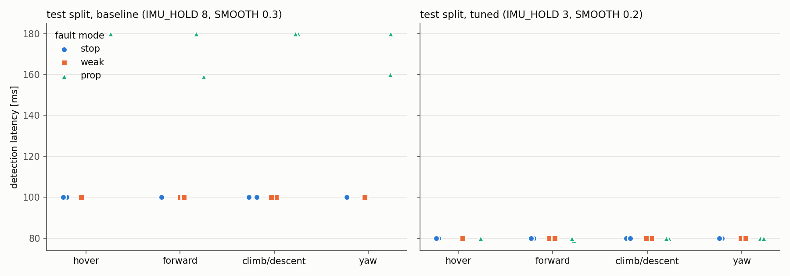
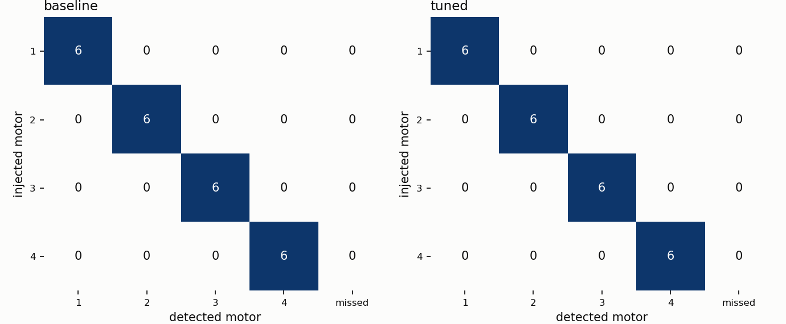
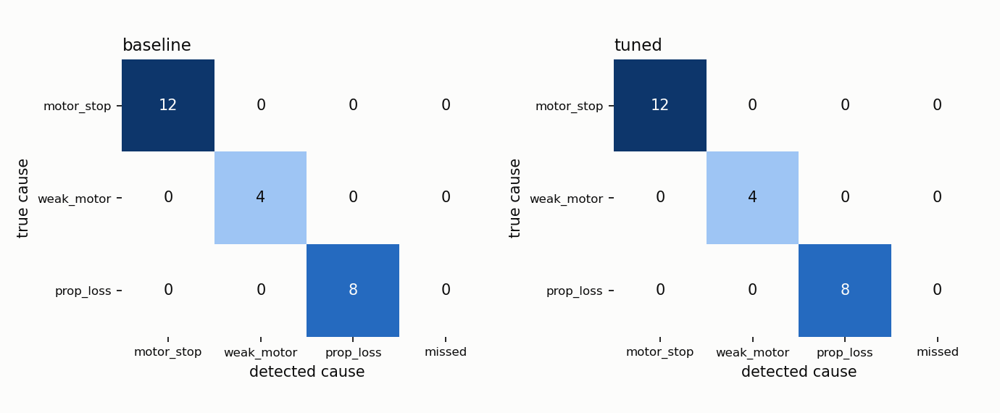

# Task 2c: Benchmark of the rotor fault detector

The detector (`src/failure_detection.py`) has two checks. The README describes them in full:
- **ESC check:** measured rotor speed vs commanded speed.
- **IMU check:** the torque the body felt vs the torque the commands should make.

The first check to fire names the motor. The cause (dead motor, weak motor or lost propeller) is read from
that motor's speed at that moment.

This report covers every item Task 2c asks for:

| Asked for | Where |
|---|---|
| Flight phases, fault models, random fault timing | [Protocol](#protocol) |
| Metrics, chosen and justified | [Metrics](#metrics-and-why) |
| Latency vs flight phase plot | [Results](#results), `results/latency_vs_phase.png` |
| Isolation confusion matrix | [Results](#results), `results/confusion_motor.png` |
| One thing tuned, before / after | [Tuning](#the-one-thing-tuned-the-imu-check) |
| .ulg per fault model with injection and detection marked | [Logs](#ulg-logs), `submission/` |

Everything is regenerated from the recorded runs by `python3 bench/analyze.py`. All numbers and tables are
in `results/metrics.md`.

---

## Protocol

**Vehicle.** Holybro X500 v2 specs (1.40 kg, 11.8 N max per rotor, 500 mm wheelbase) in PX4 SITL with
Gazebo Harmonic, using the stock PX4 controllers.

**Fault models.** Injected in the physics by our Gazebo plugin, so PX4 is never told:

| Mode | Simulates | What changes | ESC sees it? |
|---|---|---|---|
| `stop` | dead motor or ESC | rotor speed forced to 0 | yes, speed 0 |
| `weak` | weak motor | speed scaled so thrust = (1 − intensity) × normal | yes, speed low |
| `prop` | lost or damaged propeller | intensity × thrust and yaw drag removed, rotor keeps spinning | **no**, speed normal |

**Flights.** Scripted and headless (`bench/phase_flyer.py`), with no hand-flying:
- Each fault run starts a fresh sim, takes off to 3 m (13 m for descent) and flies one phase:

  | Phase | Command |
  |---|---|
  | hover | hold position |
  | forward | 2 m/s at constant height |
  | climb | 1 m/s up |
  | descent | 1 m/s down |
  | yaw | spin at 1.5 rad/s |

- The fault is injected at a **random time 2–7 s into the phase** (uniform, seeded), so it never lines up
  with the detector's 20 ms tick.
- The runtime injector `src/fault_injector.py` uses an exponential wait instead. The benchmark ties the fault
  to a phase so that every phase is covered equally.

**Schedule** (`bench/schedule.json`, seed 2026):
- 4 phase groups × 3 fault modes × 2 repeats = **24 runs per split**.
- Every motor appears 6 times per split.
- `stop` is always total. For `weak` and `prop`, one repeat is total and one is drawn from [0.5, 1.0).

**Tune / test split.** Detector settings are chosen on the 24 *tune* runs and reported once on the 24
*test* runs, so the reported numbers are not fitted to the runs they are measured on.

**Healthy flight.** One 13.0-minute session cycling all phases with no fault. The first half is used for
tuning; the second half (6.5 min) is used for reporting.

**Extra runs.** Six runs flown after tuning with the final detector, live:
- 50 % prop loss in each phase
- 50 % weak motor
- one stop

The random draw had never gone below 0.61.

**Offline replay** (`bench/replay.py`). Every run's detector inputs are recorded with sim-time stamps and
replayed through the same `Detector` class on the live node's 20 ms tick grid. Replay agrees with the live
detector to −2.1 ms on average over 48 runs (worst 20 ms, one tick). This is what lets the tuning sweep reuse
the same flights.

---

## Metrics and why

| Metric | Definition | Why this one |
|---|---|---|
| Detection rate | faults detected after injection / faults injected | the basic job |
| False verdict before the fault | fault runs where a failure was declared before injection | a false alarm inside a fault run |
| False alarm rate | raw detections per minute of healthy flight; at 0 events, the rule-of-three bound 3/T | an over-eager detector takes away a healthy motor. Raw detections are counted, so the held verdict can't hide repeats |
| Detection latency | sim time from injection to the detector's decision, mean and worst [ms] | the recovery controller needs the answer fast; the worst case is what crashes the drone |
| Isolation accuracy | correct motor / faults detected | the controller must give up the right rotor |
| Root-cause accuracy | correct fault type / faults detected | stop, weak and prop loss need different responses |

Latency is the **decision** time on the sim clock. It is not taken from message delivery, so ROS transport
doesn't distort it.

A `weak` fault at intensity 1.0 has zero rotor speed, so it is physically a stopped motor and is scored as
`motor_stop`.

---

## Results

**Test split, 24 fault runs, 6.5 healthy report minutes:**

| Detector | Detection | Latency mean / worst | Isolation | Root cause | False alarms |
|---|---|---|---|---|---|
| Before tuning (IMU_HOLD 8, SMOOTH 0.3) | 100 % (24/24) | 125 / 180 ms | 100 % | 100 % | 0 (< 0.46 /min) |
| **After tuning (IMU_HOLD 3, SMOOTH 0.2)** | 100 % (24/24) | **80 / 80 ms** | 100 % | 100 % | 0 (< 0.46 /min) |

**Per fault mode (before tuning):**
- stop and weak: 100 ms
- prop: 175 mean / 180 worst ms

The IMU check was the slow path, and the only one that sees a lost propeller. After tuning, every mode is
80 ms.

**Per flight phase:** no effect. Before tuning, hover, forward, climb/descent and yaw all give
123–127 ms mean / 180 ms worst. After tuning they are all 80 ms.



**Isolation and root cause:** every fault went to the correct motor and the correct cause, before and after
tuning.





**Extra runs (final detector, live; 50 % faults):**

| Run | Phase | Fault | Detected | Severity | Latency |
|---|---|---|---|---|---|
| extra_00 | hover | prop 0.5, motor 1 | motor 1, `prop_loss` | 0.48 | 80 ms |
| extra_01 | forward | prop 0.5, motor 2 | motor 2, `prop_loss` | 0.46 | 80 ms |
| extra_02 | climb | prop 0.5, motor 3 | motor 3, `prop_loss` | 0.48 | 80 ms |
| extra_03 | yaw | prop 0.5, motor 4 | motor 4, `prop_loss` | 0.48 | 80 ms |
| extra_04 | hover | weak 0.5, motor 1 | motor 1, `weak_motor` | 0.50 | 80 ms |
| extra_05 | hover | stop, motor 2 | motor 2, `motor_stop` | 1.00 | 80 ms |

Replay, the live node and the `.ulg` markers all agree at 80 ms. The severity estimate is within 0.04 of the
injected loss.

---

## The one thing tuned: the IMU check

**What:**
- **IMU_HOLD:** how long the IMU check must agree before declaring.
- **SMOOTH:** the low-pass weight of its torque residual.

These were pre-registered before any results, and the grid was IMU_HOLD {3, 4, 5, 8} × SMOOTH
{0.2, 0.3, 0.5, 0.7}.

**Why this:** the IMU check was the slowest path (175–180 ms), and the only one that sees a lost propeller.
The ESC check was already at its 100 ms floor.

**How:**
- Every setting was scored on the **tune split**. Per-run cost = latency if the correct motor and cause were
  found, else 1000 ms.
- **Constraint:** healthy-flight false alarms on the tune half must not exceed the baseline's (0).
- The lowest-cost allowed setting was reported once on the test split.
- The paired before/after per run was judged by the council arbiter, which promotes only if the gain beats the
  noise floor on ≥ 80 % of runs.

| IMU_HOLD | SMOOTH | Mean cost, tune split [ms] | False alarms, tune half | Allowed |
|---|---|---|---|---|
| 3 | **0.2** | **79.8** | 0 | **chosen** |
| 3 | 0.3 | 78.2 | 1 | no |
| 3 | 0.5 | 68.2 | 2 | no |
| 3 | 0.7 | 63.2 | 2 | no |
| 4 | 0.2 – 0.7 | 83.2 – 99.8 | 0 | yes |
| 5 | 0.2 – 0.7 | 100.7 – 106.5 | 0 | yes |
| 8 (before) | 0.2 – 0.7 | 120.7 – 126.5 | 0 | yes |

**Before → after, test split:**
- latency 125 / 180 → **80 / 80 ms**
- detection, isolation and root cause stay at 100 %
- 0 false alarms

**Arbiter: PROMOTE** (+45 ms per run, 1.26 × noise, better on 24/24). The detector now ships with
IMU_HOLD 3, SMOOTH 0.2.

**The trade-off the grid shows:** a faster filter (SMOOTH ≥ 0.3) at the shortest hold buys a few more
milliseconds but starts raising false alarms in healthy flight. The chosen point is the fastest one with none,
which also means it sits next to that edge.

---

## .ulg logs

One log per fault model, flown with the final detector:

| File | Fault | Injected (sim time) | Detected (sim time) | Latency |
|---|---|---|---|---|
| `submission/stop_motor2_hover.ulg` | stop, motor 2, hover | 36.080 s | 36.160 s (motor 2, stop) | 80 ms |
| `submission/weak50_motor1_hover.ulg` | weak 0.5, motor 1, hover | 35.820 s | 35.900 s (motor 1, weak, severity 0.49) | 80 ms |
| `submission/prop50_motor1_hover.ulg` | prop 0.5, motor 1, hover | 36.100 s | 36.180 s (motor 1, prop loss, severity 0.48) | 80 ms |

All 54 benchmark runs have their own `.ulg` in `runs/<run>/`.

**How the times are marked.** Both events are written into PX4's `.ulg` as a `vehicle_command` with an
unused command ID. PX4 rejects the unknown command, but its logger records every `vehicle_command`:

| Command ID | Event | param1 | param2 | param3 | param5 |
|---|---|---|---|---|---|
| 31010 | fault injected | motor | mode: 1 stop, 2 weak, 3 prop | intensity | exact sim time of the injection [s] |
| 31011 | failure detected | motor | cause: 1 motor_stop, 2 weak_motor, 3 prop_loss | severity | exact sim time of the decision [s] |

`param5` is the exact event time. In lockstep, PX4 time equals Gazebo sim time, and the log's own timestamp
of each marker lands within 1 ms of it. Reading them:

```python
from pyulog import ULog
vc = ULog('submission/stop_motor2_hover.ulg', ['vehicle_command']).data_list[0].data
for c, p1, p2, p3, p5 in zip(vc['command'], vc['param1'], vc['param2'], vc['param3'], vc['param5']):
    if c in (31010, 31011):
        print('INJECT' if c == 31010 else 'DETECT', f'{p5:.3f} s', 'motor', int(p1), 'type', int(p2), round(p3, 2))
```

---

## Limits of these numbers

- **The simulation is clean:** no sensor noise or bias, vibration, wind or model mismatch. The 100 % rates and
  the 0 false alarms are an upper bound for a real drone, not a field estimate.
- **Latency is quantised** to the 20 ms detector tick, so the "80 / 80" has ±20 ms resolution.
- **Small samples:**
  - 2 test runs per phase × mode cell
  - only 6.5 healthy report minutes, so the false-alarm rate is a bound (< 0.46 /min, or < 0.23 /min over
    all 13 min), not a measurement
- **Steady phases only:** faults are injected in steady phases, not during aggressive transitions. The tuned
  setting is the fastest one with no healthy false alarms, so harder manoeuvres are where it would break
  first.
- **Test split not fully untouched:** the fusion rule was adjusted after a first look at test results. The 6 extra
  runs, flown fresh with the final detector, confirm the numbers.
- **Sim-only ESC signal:** rotor speed comes from the simulator's joint speed. On real hardware it would come
  from ESC telemetry, which is noisier and slower (see README, Limitations).

---

## Reproducing

```bash
cd code/px4_ws && source install/setup.bash && cd ../../bench
python3 run_bench.py schedule            # seeded schedule.json
python3 run_bench.py healthy 780         # 13 min healthy flight     (~15 min)
python3 run_bench.py faults              # 54 fault runs, headless    (~60 min)
python3 analyze.py                       # metrics.md, plots, tuning, arbiter (~2 min)
```
